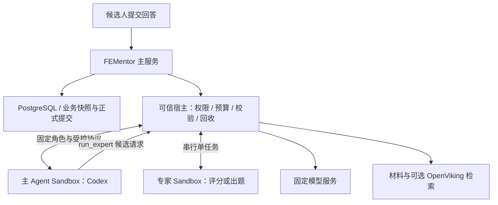

# FEMentor 多 Agent Runtime、Railway Sandbox 与共享能力方案

- 版本：v2.5
- 日期：2026-10-15
- 状态：自主主 Agent + 串行专家测试链路已验收；生产灰度、多副本恢复、Claude 与自研 Loop 待实施
- 实施清单：[多 Runtime 与共享能力分阶段实施清单](todolists/agent-runtime-openviking-implementation-todolist.md)
- 执行环境细化：[Railway Sandbox 运行与生命周期设计](railway-agent-sandbox-design.md)

## 1. 决策与当前实现

FEMentor 将 Agent 执行器与业务 Workflow 分开。用户可以选择产品已开放的 Codex、Claude Code 或自研 FEMentor Agent；服务端根据任务、权限、认证和可用能力决定是否接受选择。执行器选择与 Agent 分工独立：用户已确认新增一个自主面试主 Agent，可串行选择评分和出题专家；各角色使用的 Runtime/模型/权限仍由服务端 Profile 固定。

2026-10-10 确认以下变更，取代 v1 的 DSH-first 路线：

1. Codex、Claude Code、自研 FEMentor Agent 是同级 Runtime，不再以 DSH 为必经入口或仅以其 subagent 形式接入。
2. Railway 托管版采用“FEMentor 主服务 + 按需 Railway Sandbox”。主服务通过 Railway SDK 管理远程进程，无需为了调用 Agent 再部署一套内部 HTTP Worker Server。
3. 外层环境隔离覆盖整个 Agent 进程及其子进程。Prompt、规则、Skill 和 Hook 用于任务指导或辅助控制，不能替代文件、进程、网络与凭证的权限边界。
4. Agent 在获准环境内分析材料、使用分析工具、提交候选结果。正式业务写入与状态流转由 FEMentor 校验后执行。
5. 领域方法、规则、Skill、工具契约和记忆访问能力共享；各 Runtime 只维护加载、协议和生命周期差异。
6. 保留已有 `native-api` 与 `dsh` 实现作为迁移基线；本次不删除代码、不变更部署默认值，也不自动切换现有请求。

2026-10-15 进一步确认自主面试方向，实施规格见 [主 Agent v1](../specs/interview-director-v1.md)，执行计划见 [实施计划](../superpowers/plans/2026-10-15-interview-director.md)：

- 主 Agent 首版使用隔离的 Codex。宿主明确注入面试角色、共享 Skill、业务状态和工具说明；Codex 自主选择澄清、追问、换题、跳过、结束及专家调用。
- `run_expert` 是唯一业务工具入口，首版允许评分/出题专家，每轮最多串行调用 2 次。专家不能派生其他 Agent；主模型最多请求 4 次。
- 工具定义、输入归属、产物引用、预算与最终写入由程序检查。Prompt 决定任务方法，不能授予权限。主 Agent 不填写分数，只能引用当前 attempt 的合法专家产物。
- 主 Agent 每次用户提交启动一轮，可在该轮内连续调用专家后决策。主/子分别使用一次性沙箱，最多同时 2 个；面试连续性由数据库中的回答、对话、专家产物和提交结果恢复。
- 新路径用服务端 `INTERVIEW_ORCHESTRATOR=director` 显式启用；已验收单轮评分保留为 `workflow` 回退。具体完成状态以实施清单为准。

### 1.1 代码基线

本表仅反映 2026-10-10 对仓库 `c804e72` 的源码核对，不代表已验证线上部署：

| 项目 | 当前事实 | 本方案新增目标 |
| --- | --- | --- |
| Runtime ID | `contracts.js` 只定义 `native-api`、`dsh` | 增加 `codex`、`claude-code`、`fementor`，逐个验收启用 |
| 选择入口 | 服务端 `AGENT_RUNTIME`；代码缺省 `native-api`，`.env.example` 配置 `dsh` | 用户提交获准选项 ID，服务端解析固定 Runtime Profile |
| 生命周期 | `executeRuntimeTask()` 每个任务 start，finally close | 业务会话映射执行会话，支持租约、超时、重连和环境销毁 |
| DSH 并发 | API 共享 `DshRuntime`，最多一个 active run，忙时拒绝 | 有界持久化调度，不把多个租户放入一个共享执行环境 |
| 权限 | DSH 有环境变量筛选及受限 profile | 新增整个实例的外层隔离，不能把 cwd/env 筛选视为沙箱 |
| 审计 Schema | migration 003 有 `agent_runtime_session`、`agent_run` | 扩展环境、租约、幂等和提交记录；不能假设现有表已支持新状态 |
| 证据检索 | `retrieveEvidence()` 仍返回空引用；面经召回另有 embedding/图谱链路 | 后续受限 evidence bundle 与 OpenVikingGateway |

源码入口：[契约](../../apps/api/src/agent-runtime/contracts.js)、[执行生命周期](../../apps/api/src/agent-runtime/execute-task.js)、[运行时选择](../../apps/api/src/agent-runtime/interview-runtime.js)、[DSH 配置](../../apps/api/src/agent-runtime/dsh-config.js)、[审计 migration](../../apps/api/migrations/003_agent_runtime_audit.sql)、[检索入口](../../apps/api/src/retrieval/index.js)。

随后实施的首个切片新增 [CodexSandboxRuntime](../../apps/api/src/agent-runtime/codex/runtime.js) 和 [合成评分入口](../../apps/api/scripts/codex-sandbox-smoke.js)：真实 Sandbox 中 Codex 返回评分，宿主校验后确认销毁。随后已加入服务端 `AGENT_RUNTIME=codex` 选择，并用 `CODEX_SANDBOX_ENABLED=1` 显式启用。真实面试接口复用现有 turn service，在 Codex 分支先规划、后原子提交，使用独立合成数据验证；线上默认配置未切换。版本、运行 ID、网络检查与未完成边界见 [第二个切片记录](railway-agent-sandbox-design.md#10-2026-10-10-出站隔离与面试接口接入)。

第四个切片已在独立 Railway 测试环境完成运行中 SIGKILL → 自动重启 → 已知 Sandbox 回收 → 同一回答重新提交的实际验证。回收器依赖单 API owner 与持久化日志，保留未知创建结果的人工核对，尚无多副本租约或业务重放；证据见 [异常退出回收记录](railway-agent-sandbox-design.md#12-2026-10-10-异常退出后的资源回收)。

## 2. 职责边界

| 层 | FEMentor 应持有的能力 | 不应放入这一层的能力 |
| --- | --- | --- |
| 业务状态与提交程序 | 身份/归属、题目队列、评分契约、配额、复盘、候选校验与正式提交 | 外部 Agent 的私有线程对象 |
| 面试主 Agent | 理解本轮回答、自主选择面试动作与获准专家、解释合法结果 | 自选 Runtime/权限、直接填写正式分数或写库 |
| 运行宿主 | Runtime 选择、TaskBundle、调度、deadline、租约、校验、审计、环境回收 | 让另一个 LLM 代替程序实施权限 |
| SandboxManager | 创建/连接/销毁隔离环境，文件交付，进程通道，资源策略验证 | 面试评分和题库写入 |
| AgentRuntime Adapter | Codex/Claude/自研协议、事件归一化、认证配置引用、能力协商 | 直接改变业务数据库 |
| Agent Harness | 模型与工具循环、内部上下文、局部规划和恢复 | 跨用户访问及最终业务裁决 |
| 共享能力包 | 评分 rubric、任务 Skill、规则、输入输出 Schema、工具定义和加载素材 | 数据库密码、运行时租约、可绕过的业务检查副本 |
| 记忆/检索服务 | 主服务持有的权限过滤、范围检索、证据读取、记忆候选审核 | 让插件自动覆盖正式评分或能力画像 |

这里的 FEMentor 运行宿主是可信程序模块；面试主 Agent 是由该程序装配角色和工具的 Codex 实例。自研 `FEMentorAgentRuntime` 则是未来可替换 Codex 的 Agent Loop，三者职责不同，可独立演进。稳定业务约束必须在程序中执行；Skill 中可保留分析方法和无特权辅助脚本，同一脚本也可被自研 Runtime 调用。

PostgreSQL 是目标架构的唯一结构化业务真源，文件/对象存储保存原始材料。OpenViking 是可重建的上下文与索引层。单库收敛的完成情况以其专项清单和实际验证为准，不因本次方案更新视为完成。

## 3. 总体架构与部署



图中“受控模型入口”在合成原型中已实现为通过 SDK 控制通道回传的宿主模型转发；现已通过独立 network/PID namespace、仅 loopback 接口和无特权身份阻断 Agent 直接出站，模型走同一 stdio 中继；Railway 默认联网本身不提供这一约束。

### 3.1 Railway 托管版

- 主服务继续承载 API、业务权限、数据访问和调度模块。首期不增加独立 HTTP Worker 服务，也不在 API 容器内嵌套启动 Docker 来隔离 Agent。
- 通过 Railway SDK 创建独立 Sandbox，将已安装执行器和依赖的干净模板用于启动；用户材料、凭证和会话日志不进入共享模板。
- Codex 在 Sandbox 内运行 App Server，主服务经 SDK 的进程输入输出通道交互。跨网络通信由平台承载，不等于本机 `spawn()`，也不要求开放 Sandbox 公网端口。
- 默认 `ISOLATED`，不发布 Sandbox 域名。主服务查询数据后投递任务包；结果沿原通道返回。首期不要求 Sandbox 直接连接数据库、OpenViking 或主服务内网。
- Railway 管理凭证、数据库密钥、对象存储管理密钥留在主服务。模型认证使用已验证的专用服务配置，长期凭证优先由模型网关保管；不得复用当前开发者桌面登录态。
- 本方案的网络目标是只允许必要模型入口；默认 `ISOLATED` 仍有公网出站，完整出网限制作为托管启用前的必验项，详见执行环境设计。

### 3.2 本地自部署

- 使用相同 Runtime、TaskBundle、Skill 和提交契约，替换为本地容器/虚拟机实现的 SandboxManager。
- 本地直接子进程只可作为明确标注的开发模式，不宣称具有与托管沙箱相同的隔离能力。
- 部署者通过服务端配置管理可用执行器和认证。浏览器不读取 Agent 凭证，不提交任意命令、镜像、MCP 地址或模型 Base URL。
- 平台隔离实现不同，不改变 PostgreSQL、文件及派生索引的权威边界。

## 4. 执行器选择与能力共享

### 4.1 执行器路线

| Runtime | 集成方式 | 计划定位 |
| --- | --- | --- |
| `codex` | Sandbox 内 App Server，Adapter 收发其协议 | 首个沙箱评分切片 |
| `claude-code` | Sandbox 内运行官方 Agent SDK/CLI 及 FEMentor 适配进程 | 第二个执行器；须单独验证取消、会话、Skill、认证和输出协议 |
| `fementor` | 自研模型/工具循环，以同一任务协议运行 | 按需建设，可在程序中实现专属上下文、工具调度和步骤策略 |
| `native-api` | 现有受限模型 API 调用 | 保留比较及显式回退路径，不等于完整自研 Agent Harness |
| `dsh` | 现有适配器 | 兼容路径；不再是其他执行器或记忆接入的前置条件 |

首期接通 Codex 不等于其余执行器已经可选。UI 仅展示服务端确认可用的 Profile；用户可选执行器不代表可自定义权限。运行中的任务固定 Profile 版本，切换执行器从下一个合法任务边界开始，按业务快照重建上下文，不搬运私有线程对象。失败时明确返回错误，不能未经明确策略跨执行器重试。

### 4.2 共用插件与自研 Harness

共享能力以一个版本化源包维护，各平台生成自己的安装配置；不假设一份插件 manifest 能直接跨平台运行。

| 共用内容 | 外部 Agent 如何接入 | 自研 Agent 如何接入 |
| --- | --- | --- |
| 任务方法、评分 rubric、输出说明 | Skill 与规则素材 | 同源 Prompt/SkillLoader |
| 输入输出 Schema、工具定义 | Adapter 转换为对应协议 | 直接使用同源定义 |
| 记忆与证据查询 | 首期由 TaskBundle 提供；后续由经校验的工具桥接提供 | 同一受限查询接口 |
| 分析辅助脚本 | 在沙箱临时目录执行，无业务写凭证 | 可直接调用相同模块或脚本 |
| 配额、状态流转、落库、审批条件 | FEMentor 服务端执行 | 仍由 FEMentor 服务端执行 |

共享记忆指共享访问契约和同一用户的已审核资料，不是多个用户共用可读写文件夹。记忆写入采用候选提交，审核/校验后由主服务持久化；不让每种 Agent 各自沉淀一套不可追踪的正式画像。

## 5. Runtime 与任务契约

以下为目标契约，未修改现有代码。保留 `startSession/runTurn/resumeSession/cancelTurn/closeSession` 的概念；把会话结束和 Sandbox 销毁分别交给 Runtime 与 SandboxManager 管理。

| 契约 | 关键字段/约束 |
| --- | --- |
| RuntimeProfile | `runtimeId`、固定版本、模型配置引用、共享能力包版本、工具策略、输出 Schema 版本；由服务端登记 |
| TaskBundle | `runId`、`taskType`、输入、必要业务快照、证据/记忆子集、资源 hash、Skill refs、Schema、预算；不带管理凭证 |
| RunPolicy | 服务端绑定 owner、业务 session、资源范围、允许工具、deadline、并发和提交权限；不由模型输出覆盖 |
| ExecutionSession | FEMentor ID 映射 sandbox ID、远程进程会话 ID、Agent thread ID、owner、租约及 generation；仅后台可见 |
| CandidateResult | `runId`、任务 Schema 内的数据、证据引用；由主服务从已绑定通道接收，不信任结果自报的身份 |
| Commit | 服务端校验 Schema、业务版本、归属、证据和幂等后提交；Agent 完成与业务提交分开记录 |

预算字段要区分“配置了”与“实际可强制执行”。无法精确限制内部步骤或 Token 的执行器必须报告能力差异，至少执行外层 deadline、并发、输出大小和资源上限，不把估算成本冒充硬预算。

事件继续归一为 FEMentor 业务可消费的事件。`completed` 仅表示执行器产出候选结果；面向用户的成功结果必须在提交完成后发出。原始工具输出、内部推理、系统指令和未校验评价不直接转发给浏览器。

首期业务工具集可以为空：只给任务包，接收候选结果。后续需要主动查询时，由 Adapter 将执行器工具请求转给主服务的 ToolGateway。Codex 动态工具通道属于实验能力，须单独验证；不支持的执行器继续使用任务包，不为兼容而开放任意 HTTP/数据库权限。

## 6. OpenViking 与上下文设计（后续阶段）

本节保留原方案的资源映射与证据边界，消除对 DSH 插件的依赖。URI/API 示例源于 2026-08 的设计调研，进入该阶段时须重新核对安装版本；不作为已实现能力清单。

### 6.1 采用的官方使用模式

OpenViking 官方视频与 Coding 方案采用的是同一条上下文闭环：

```text
资源导入
  -> 按业务目录组织
  -> L0 快速筛选
  -> L1 理解与导航
  -> L2 按需读取原文
  -> Agent 执行与验证
  -> 中间产物、结果和经验回写
```

映射到 FEMentor：

1. `resources` 保存可引用的简历、JD、面经和公开知识。
2. `memories` 保存跨场次发生过的事件、偏好、实体和可复用经验。
3. `skills` 保存面试 Agent 可按需加载的任务说明和 rubric。
4. `sessions` 保存一次 Agent/面试上下文的消息、归档和记忆变更记录。
5. FEMentor Workflow 决定何时检索、允许访问哪些范围，以及 Agent 结果是否写入业务库。

沿用官方 Coding 方案的职责表述：**记忆负责发生过什么，检索负责去哪里找，FEMentor 的业务库和对象存储负责现在是什么**。

### 6.2 主服务统一接入

由 `OpenVikingGateway` 统一处理身份、限定范围检索、资源导入、会话投影和异步状态。各种 Runtime 消费相同的 evidence/memory bundle；以后开放主动查询时，仍通过 FEMentor 的受限工具契约。

记忆与证据是两个用途：正式评分引用必须能够回查权威材料；偏好和历史经验只作辅助上下文。由主服务确定每个业务会话/任务对应的 OV session 映射和唯一写入者，按消息/事件 ID 幂等同步。运行时插件不能再独立重复捕获、自动 commit 同一份正式记忆。

OpenViking 可选且后置；Runtime、共享 Skill 和 Sandbox 生命周期都不依赖它先上线。原 DSH Memory Plugin 双通道仅保留为历史研究，不再作为本方案默认实现。

### 6.3 权威存储边界

| 数据 | 权威存储 | OpenViking 中的角色 |
| --- | --- | --- |
| 用户、面试场次、题目、回答、评分、配额 | PostgreSQL | Session 上下文或引用，不作为业务真源 |
| 简历、JD 原文件和解析结果 | 对象存储或本地文件 + 数据库元数据 | 用户私有 `resources` 镜像 |
| 公开面经原文、清洗结果、题目结构 | PostgreSQL | 公共 `resources` 镜像，供语义导航和证据读取 |
| 用户可见的能力画像和复盘结论 | FEMentor 结构化记录 | 可投影为 `memories`，用于辅助召回 |
| Agent 会话投影和自动提炼记忆 | OpenViking | 辅助上下文；由主服务管理同步，不直接覆盖业务画像 |
| 面试策略、评分规则、Workflow Skill | Git 中的版本化 Skill 文件 | 部署到 `skills` 的运行时副本 |
| L0/L1 摘要、向量、检索分数 | OpenViking | 派生索引，可重建 |
| 检索结果 | 非权威临时数据 | 返回 URI、层级、分数、来源和按需正文 |

资源导入失败或 OV 暂时不可用，不应影响数据库和对象存储中的原文件有效性。业务数据删除时必须由 FEMentor 发起显式清理任务，并记录数据库、对象存储和 OV 三处的删除结果。

### 6.4 URI 与目录设计

使用不可变的内部 UUID，不使用邮箱、文件名或用户输入直接构造 URI。

```text
viking://resources/fementor/
└── experiences/
    └── {experience_post_id}/
        ├── source.md
        └── normalized.md

viking://user/{ov_user_id}/resources/fementor/
├── resumes/{context_resource_id}/
│   ├── source.md
│   └── parsed.md
└── jds/{context_resource_id}/
    ├── source.md
    └── parsed.md

viking://user/{ov_user_id}/memories/
├── preferences/
├── entities/
├── events/
├── cases/
├── trajectories/
└── experiences/

viking://user/{ov_user_id}/sessions/{ov_session_id}/
viking://user/{ov_user_id}/skills/{skill_name}/
viking://agent/skills/{shared_skill_name}/
```

面试场次不复制简历和 JD 原文。现有简历/JD 没有独立业务表 ID，因此由稳定的 `context_resource.id` 映射当前文件或对象存储路径，再关联目标索引同步记录；面经直接使用现有 `experience_post.id`。`interview_session` 保存本次使用的资源引用、允许的面经集合和对应 `viking://` URI。这样同一资源只导入一次，场次通过不可变引用固定证据范围。

公共面经只放已审核、允许所有租户访问的内容。用户上传、私有面经和未公开材料必须放在用户 namespace，不能放入 `viking://resources`。

### 6.5 用户、Peer 与会话隔离

托管版建议建立一个 FEMentor account，并为每个 FEMentor 用户映射一个 OV User：

1. ROOT Key 只用于创建 account/user、轮换 Key 和运维，不用于普通数据请求。
2. Backend 为每个业务请求解析出固定 `ov_user_id`，再以该用户身份调用 OV；OV Key 不下发浏览器。
3. `ov_user_id` 使用稳定的内部 ID，禁止让客户端自行传入。
4. 明确业务会话与 OV session 的映射，每个 Agent run 记录所用映射；不按每次进程启动重复创建并提交同一批消息。
5. 若一个 OV User 下需要隔离多个工作区或外部参与者，再使用 `peer_id`；Gateway 按任务显式设置 peer，召回使用 `peer_scope=actor`。

第一阶段不把 `peer_id` 当作用户隔离手段。用户隔离必须由 OV User/API 身份完成，Peer 只是在同一用户内部进一步限定工作区。开源单用户版可以使用一个本地 User，但仍沿用相同 URI 结构，避免以后迁移时重写数据。

### 6.6 资源导入与更新

1. 用户上传文件由 FEMentor 先写入权威存储，再通过 TypeScript SDK `addResource` 导入用户私有目标 URI。
2. 默认异步导入，保存 `task_id / root_uri / source_hash / indexed_at / status`；需要立即检索时才使用有界 `wait=true`。
3. 用户上传文件是一次性快照，内容变化后按新 hash 重新导入，不创建 Watch。
4. 公开面经源、文档站或代码仓库可以由后台任务使用 Watch 增量同步；Watch 的创建、取消和凭证更新只允许 Backend 执行。
5. 检索只使用处理完成且 hash 与权威源一致的资源。旧版本在切换成功后再清理，避免导入窗口导致证据不可用。
6. 对外部来源凭证使用 OV 的结构化鉴权参数，不把 token 嵌入 URL、日志或资源路径。

### 6.7 检索与读取策略

正式评分证据采用“先定位、再读取”的渐进式流程：

```text
FEMentor 生成 query 和允许的 target URIs
  -> find 或 search(mode="list") 返回 L0/L1 候选
  -> FEMentor 校验 URI 仍在白名单前缀内
  -> read 读取少量命中的 L1/L2 正文
  -> Agent 基于 URI + 原文生成评分或追问建议
  -> FEMentor 持久化最终结果和引用
```

调用边界：

| 接口 | FEMentor 用法 |
| --- | --- |
| `find()` | 默认路径。查询意图明确、需要低延迟且必须用 `targetUri` 严格限域时使用 |
| `search(mode="list")` | 查询依赖当前会话语义、需要意图扩展时使用；仍必须传 `session_id` 和允许的 `target_uri` |
| `search(mode="context")` | 仅用于身份和 Peer 已隔离后的通用 Agent 自动召回；首版不用于正式评分证据 |
| `read()` | 只读取通过 URI 前缀校验的少量候选；目录先读 L1，必要时再读 L2 |
| `grep/glob` | 精确术语、题号、公司名或文件定位的补充路径，不替代语义检索 |

`search(mode="context")` 当前不支持 `target_uri`，所以不能满足“本次只允许访问指定简历/JD/面经”的硬约束。Backend 可以在用户/Peer 隔离后将其用于辅助记忆召回，但该结果不能直接作为正式评分证据。正式评分必须保留可审计的资源 URI、读取层级、source hash/revision 和引用正文。

Agent 可以建议 query 或请求加深读取，但不能传入任意 `target_uri`。目标 URI 由 FEMentor 根据本次 session 的资源引用在服务端生成。

### 6.8 Session、commit 与长期记忆

所有 Runtime 共用主服务管理的同步路径：

1. 每个 Agent run 创建或复用一个明确映射的 OV session。
2. 只写入对后续理解有价值的 user/assistant 消息和必要的上下文引用；原始大工具输出留在业务日志或对象存储，以 URI 引用进入 OV。
3. 单轮评分完成不立即把模型判断当作稳定记忆。
4. 在 `retrospect` 完成、正常关闭或达到明确阈值时 commit。
5. commit 的 Phase 1 会立即归档，Phase 2 的摘要和记忆提炼异步执行；需要记录 `task_id` 并观测完成/失败，不能把 accepted 当作已提炼完成。

Agent 退出或 Sandbox 被销毁不代表记忆已提交。主服务只同步已确认的消息和业务结果，用 outbox 重试与核对任务状态；不依赖 Agent 的 teardown hook 完成正式记录。

OV 自动提炼的记忆只用于后续 Agent 召回。用户可见的 `stable_strengths / stable_weaknesses / recommended_focus` 仍由 FEMentor retrospect 流程生成、校验和持久化，不能被 OV 自动记忆直接覆盖。

### 6.9 Agent 的记忆与证据工具策略

首期评分只接收 Backend 预取的 bundle。后续最多开放 `retrieve_interview_evidence`、`read_allowed_memory` 等业务工具，资源身份与范围由主服务绑定；Agent 不能传任意用户、路径或 OV URI。

资源导入、编辑、删除、Watch 管理、Skill 发布和正式记忆写入均由 Backend 执行。`propose_memory` 只提交候选，不直接调用 OV 写接口。即使通过 MCP 分发，也必须由服务端鉴权与校验；MCP 协议本身不提供业务权限保证。

## 7. 结果校验与业务提交

1. 身份和资源范围从已授权请求解析；候选人回答、简历/JD、面经、工具结果和记忆作为不可信内容处理。
2. 各执行器共用输入输出 Schema 和业务 Validator。评分校验枚举、条件必填、长度、总分范围、维度范围与总分一致性；证据引用只能来自获准 bundle。
3. 追问数量、关键词轮次、题目重复、面试状态和配额由程序检查；Agent 只能建议下一步。
4. 候选结果通过后，在事务内检查业务版本与幂等键，再写评分/题目队列和提交记录；进程正常退出不等于结果可提交。
5. 正式面试中的参考答案披露策略、Prompt Injection 处置和 SSE 输出校验沿用统一服务端策略。只发送安全状态进度；未经校验的评价、答案和内部工具内容不直接流向候选人。
6. 无效输出可在预算内修复一次；仍不合法则明确失败，不把占位值或另一个模型的临时回复当作已验收评分。
7. 失败、超时、取消、版本冲突和租约失效不得推进面试状态。重复结果只可读回原提交，不重复扣配额或写入。

## 8. 隔离与凭证策略

外层隔离负责限制影响范围，服务端校验负责决定业务提交能否生效。Agent 内部在临时目录进行无特权分析，不需要 FEMentor 审核每一条 Python/Shell 指令；所有可访问或改变业务数据的入口则必须由主服务掌握。

- 不将整个 FEMentor 仓库、宿主 HOME、Docker 管理 socket、数据库网络凭证或 Railway 管理凭证放入 Agent 环境。
- 任务输入和共享包以只读方式提供，临时目录可写；该权限必须对 Agent 的实际 OS 身份生效，Agent 不得拥有可撤销限制的提权或网络管理能力。
- `ISOLATED` 只解决项目私网隔离，不等于公网 allowlist。必须验证不可绕过的出网路径；代理环境变量、Prompt 和插件工具列表均不能单独证明隔离完成。
- 不连接在沙箱外拥有广泛执行或写入权限的 MCP/宿主工具。远程工具的副作用不受本地文件沙箱约束。
- 只向 Agent 提供短期、限用途身份。真实模型凭证的代理转发需验证协议兼容性与部署支持；网关限制上游、模型、路由、请求大小和额度，不能是任意地址转发器。
- 不以当前桌面账户的 auth/session 文件替代托管产品认证。外部执行器的服务端使用方式和可用模型需在接入阶段单独确认。
- Codex 内层沙箱可保留为额外限制；`externalSandbox` 只表示由外部承担隔离，不能通过设置该字段凭空获得沙箱。启用前必须验证外层策略，失败时拒绝新任务。

具体网络验证、租约、取消和销毁标准见 [Railway Sandbox 运行设计](railway-agent-sandbox-design.md)。

## 9. 迁移策略

本次只更新文档。代码基线中的 DSH/native 配置、依赖和数据库 Schema 保持原样，新 Runtime 必须完成验收后才加入服务端可选列表。

- 首个任务为 `evaluate-answer`，先验证无业务工具的任务包输入与结构化候选输出。
- 复用现有 Runtime 边界、评分流程和审计记录，不复制整套面试逻辑；新增 SandboxManager 和 Codex Adapter。
- 原 `executeRuntimeTask()` 的逐任务关闭语义需要改造或增加新的执行宿主，不能直接把 closeSession 等同销毁整场面试环境。
- 旧 [DSH Worker Pool 设计](dsh-worker-pool-design.md) 标为历史方案；其有界调度、幂等和恢复目标迁入通用运行设计，不继续建设 DSH 专属进程池作为前置步骤。
- 自研 Agent 与外部 Agent 同级接入。只有出现明确的专属循环、上下文或成本需求时，才实现自研 Loop；固定业务逻辑先收敛为共享后端服务。
- 新路径按任务灰度，保留可追踪的显式回退。Runtime 切换与业务 pipeline、LLM client、数据库迁移分别配置，避免一个开关改变多个边界。

## 10. 实施顺序

```text
代码基线与契约
  -> Railway Sandbox 进程通道和权限验证（合成材料）
  -> Codex Adapter + 共享 Skill + 单轮评分 + 结果提交
  -> 回答持久化 / 取消回收 / token 预算
  -> 主 Codex 自主决策 + 串行评分/出题专家 + 受控提交
  -> Claude Adapter + 用户可选 Runtime
  -> 按任务扩展 / 按需自研 FEMentor Agent

并行数据主线：PostgreSQL 单库收敛
  -> 稳定资源身份与 outbox
  -> OpenViking 同步与受限证据检索
  -> 共用记忆候选与审核闭环
```

无需等待 Claude、自研 Agent 或全部面试任务迁移完成，才开始独立的数据工作；正式 OV 接入仍须通过数据主线与所接业务任务的验收。详见 [实施清单](todolists/agent-runtime-openviking-implementation-todolist.md)。

## 11. 核实事项与资料

已确认产品方向。合成验收已验证当前账户创建/销毁、指定版本协议、身份/只读目录、内核出站隔离和真实面试 HTTP/SQLite 提交；以下涉及生产使用的完整条件仍需逐项验收：

- Railway 当前账户的 Sandbox 可用性、区域、并发和预算；SDK 对 Node.js 的要求及现有部署兼容性。
- SDK 远程 stdin/stdout 对所选 Codex 版本的兼容性，断线后协议重连能否正确恢复。
- 已实测的 loopback-only、文件只读和非特权策略需在部署环境逐 run 验证；真实用户灰度仍须通过可靠性、披露和生产 PostgreSQL 验收。
- Codex App Server 实验性接口及托管认证支持；Claude SDK/CLI 的版本、服务部署认证与输出契约。
- 具体模型入口、费用归属、日志脱敏、会话保留周期；预算未知字段保留 unknown，不记为零。
- OpenViking 的 SDK/URI/commit 行为按进入该阶段时的实际版本复核。

2026-10-10 核对的官方资料：[Railway Sandbox](https://docs.railway.com/sandboxes)、[Railway 私有网络](https://docs.railway.com/networking/private-networking)、[Codex App Server](https://learn.chatgpt.com/docs/app-server)、[Codex 容器与权限说明](https://learn.chatgpt.com/docs/agent-approvals-security)。官方资料与本仓库原型实测的范围分开记录，不能将单轮评分通过视为全部隔离及生产可靠性通过。

## 12. 历史附录：DSH GitHub 调研结论（不再决定实施顺序）

以下保存 v1 的调研依据和当时结论，均不代表 v2 当前选型；涉及 DSH-first、one-shot subagent 和自动 Memory Plugin 的决策已由第 1—11 节取代。

调研基线：`deepseek-ai/deepseek-harness` `master@b150a55`，版本 `0.1.1-rc.2`；2026-08-26 已重新确认 master commit 和关键文档链接仍有效。以下结论来自官方文档、当前源码契约和 GitHub Discussions，仍需在 FEMentor 原型中验证。

### 12.1 推荐的宿主集成接口

DSH 官方当前提供 Python SDK 和 TypeScript `@deepseek-ai/dsh-sdk-client`，两者通过子进程 stdio JSON-RPC 驱动完整 runtime。FEMentor 的 `DshRuntime` 应优先使用这一接口，不直接依赖 DSH Web Host、Cordis、Typert 或内部 API Gateway 类型。

API Gateway 当前主要覆盖 unary Remote，并不提供稳定的 session 增量事件协议。DSH 仍处于 developer preview，官方明确提示后续可能发生破坏性变更。

参考：

- [Python SDK guide](https://github.com/deepseek-ai/deepseek-harness/blob/master/docs/user/guide/python-sdk.md)
- [TypeScript SDK client](https://github.com/deepseek-ai/deepseek-harness/blob/master/packages/sdk/client/README.md)
- [API Gateway](https://github.com/deepseek-ai/deepseek-harness/blob/master/docs/api-gateway.md)
- [Discussion #2981](https://github.com/deepseek-ai/deepseek-harness/discussions/2981)
- [Discussion #4377](https://github.com/deepseek-ai/deepseek-harness/discussions/4377)

### 12.2 Codex 与 Claude Code subagent 的真实能力

Codex provider 会启动 DSH 包内精确锁定版本的 Codex wrapper，通过 `app-server --stdio` 创建临时 thread；Claude Code provider 会通过包内 Agent SDK 启动新的 CLI process。它们调用的是真正 Agent，不只是同名模型。

两个 provider 当前都是 one-shot：每次调用创建新进程和新会话，只返回最终结果，不支持 continuation、resume、process pool 或完整 progress stream。因此它们适合简历分析、单题校验、证据摘要等自包含 Worker，不适合承载整场面试状态。

本地认证可以通过 `HOME`、`CODEX_HOME` 和产品原生设置读取已有登录态，但 DSH 不应复制或上传这些凭证。credential-shaped 环境变量默认会被清理；显式 API Key 需要由 provider 配置主动注入。

参考：

- [Codex provider](https://github.com/deepseek-ai/deepseek-harness/blob/master/packages/subagent/subagent-codex/README.md)
- [Claude Code provider](https://github.com/deepseek-ai/deepseek-harness/blob/master/packages/subagent/subagent-claude-code/README.md)
- [Subagent subsystem](https://github.com/deepseek-ai/deepseek-harness/blob/master/docs/subsystems/subagent.md)

### 12.3 取消、超时与沙箱边界

Codex/Claude Code provider 当前没有 wall-clock timeout 和副作用回滚。provider 的 `dispose()` 可以终止整个 process tree，但 SDK wire 没有单次 prompt 的中途取消；必要时只能关闭并重建整个 runtime。

DSH workflow worker 虽支持 cancel/dispose 和并发上限，但官方明确说明 `node:vm` 不是安全边界。FEMentor 仍需自行提供 deadline、成本预算、并发配额、重复任务指纹、进程关闭重建、独立工作目录和副作用审计。

参考：

- [SDK client limitations](https://github.com/deepseek-ai/deepseek-harness/blob/master/packages/sdk/client/README.md)
- [Workflow subsystem](https://github.com/deepseek-ai/deepseek-harness/blob/master/docs/subsystems/workflow.md)
- [Workflow worker thread](https://github.com/deepseek-ai/deepseek-harness/blob/master/packages/workflow/workflow-worker-thread/README.md)
- [Discussion #4449](https://github.com/deepseek-ai/deepseek-harness/discussions/4449)

### 12.4 OpenViking 与 Skill 的组合方式

DSH 社区调研阶段建议把 OpenViking 拆成 Skill 和检索工具。结合后续确认的 OpenViking 官方 DSH 插件，目标架构进一步收敛为：

```text
OpenViking 官方 DSH Memory Plugin
  -> 自动召回、会话捕获、commit、openviking-memory Skill

FEMentor OpenVikingGateway
  -> 限定范围检索与读取，返回 URI、source revision、score 和正文
```

Skill 负责提供按需加载的任务说明；官方插件负责 DSH 的通用记忆闭环；Gateway 负责正式业务证据。是否检索、检索范围和结果是否进入评分仍由 FEMentor 状态机决定。

参考：

- [Skills subsystem](https://github.com/deepseek-ai/deepseek-harness/blob/master/docs/subsystems/skills.md)
- [Skill registry](https://github.com/deepseek-ai/deepseek-harness/blob/master/packages/skill/skill/README.md)

### 12.5 当时对 v1 方案的影响（已取代）

第一阶段只维护：

1. `NativeApiRuntime`
2. `DshRuntime`

`DshRuntime` 通过官方 subprocess SDK 接入，并在 adapter 内把 JSON-RPC notification 转换为 FEMentor 自有事件。第一阶段只运行 DSH 原生 Agent，通过 provider 切换不同模型。Codex、Claude Code subagent 延后接入，暂不实现对应直连 adapter。

DSH 依赖必须精确锁定版本并建立兼容测试，不使用 caret 范围自动升级。如果 RC 阶段的 SDK 或插件 ABI 持续破坏核心体验，本地版应能退回 `NativeApiRuntime`。

参考：

- [DSH README](https://github.com/deepseek-ai/deepseek-harness)
- [Release PR #2908](https://github.com/deepseek-ai/deepseek-harness/pull/2908)
- [Discussion #4473](https://github.com/deepseek-ai/deepseek-harness/discussions/4473)
- [Discussion #1711](https://github.com/deepseek-ai/deepseek-harness/discussions/1711)

## 13. OpenViking 官方资料依据

本轮调研日期为 2026-08-25，关键官方链接于 2026-08-26 重新验证可访问。OpenViking 文档更新较快，进入实现阶段时仍需要再次核对 SDK 类型和插件版本。

- [视频创作方案](https://www.openviking.ai/solutions/video)：业务目录、L0/L1/L2 渐进读取和产物回写闭环。
- [Coding Agent 方案](https://www.openviking.ai/solutions/coding)：resources/memories 分工、跨会话记忆与“当前事实”边界。
- [核心概念](https://www.openviking.ai/concepts)：URI、Resource/Memory/Skill、分层上下文和版本能力。
- [API 概览](https://docs.openviking.ai/zh/api/01-overview)：TypeScript/Python/Go SDK、HTTP、CLI 和认证入口。
- [资源 API](https://docs.openviking.ai/zh/api/02-resources)：资源类型、异步处理、目标 URI、tags 和 Watch。
- [检索 API](https://docs.openviking.ai/zh/api/06-retrieval)：`find`、`search`、context mode、分层结果和范围限制。
- [会话 API](https://docs.openviking.ai/zh/api/05-sessions)：消息、归档、commit 两阶段、异步记忆提炼和审计记录。
- [记忆 API](https://docs.openviking.ai/zh/api/16-memory)：内置记忆类型和预算召回。
- [Skill API](https://docs.openviking.ai/zh/api/04-skills)：user-scoped Skill、校验、更新和删除边界。
- [多租户 API](https://docs.openviking.ai/zh/api/08-admin)：ROOT/ADMIN/USER、Account/User 和 API Key 管理。
- [服务端快速开始](https://docs.openviking.ai/zh/getting-started/03-quickstart-server)：服务启动、`doctor`、`health` 和认证。
- [DSH Memory Plugin](https://docs.openviking.ai/zh/agent-integrations/17-dsh)：DSH 进程内插件、自动召回、消息捕获、pending 和 session 映射。
- [Agent 集成能力参考](https://docs.openviking.ai/zh/agent-integrations/16-capability-reference)：MCP 工具面、commit 生命周期、删除风险和各 Harness 差异。
