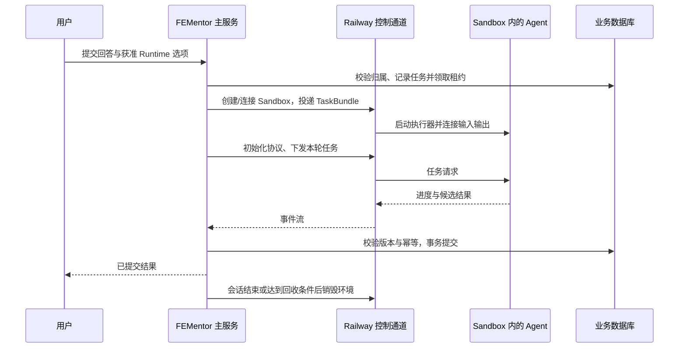

# Railway Sandbox Agent 运行与生命周期设计

- 版本：v1.6
- 日期：2026-10-15
- 状态：云端评分、回答恢复及自主主 Agent + 串行专家链路均通过；当前主 Agent 证据见第 14 节
- 主方案：[多 Agent Runtime 与共享能力](agent-runtime-openviking-preliminary-design.md)
- 任务清单：[分阶段实施清单](todolists/agent-runtime-openviking-implementation-todolist.md)

## 1. 部署决定

Railway 托管形态采用常驻 FEMentor 主服务管理按需 Sandbox，数据库、对象存储和可选 OpenViking 继续在沙箱外。首期由主服务里的调度模块持有 SDK 连接，不为了调用 Codex 额外部署 HTTP Worker Server。

这与在主 API 服务里启动 Codex 子进程不同：外部 Agent、它启动的分析脚本及本地工具都在独立环境中。也不要求在 Railway 普通 Service 内运行嵌套 Docker。

若以后长连接数量、任务规模或部署频率需要分离调度进程，可以增加受信任的 Coordinator 服务；这是运维扩展，业务契约和 Agent 的环境边界保持不变。



## 2. 实现模块

以下是目标职责划分；本次已实现的原型文件见第 9 节，其余模块仍待实施：

| 模块 | 所在位置 | 职责 |
| --- | --- | --- |
| RunCoordinator | 主服务 | 接单、限流、领取租约、任务顺序、重试决策、回收 |
| TaskBundleBuilder | 主服务 | 按权限准备业务快照、题目/回答、必要证据和记忆 |
| SandboxManager | 主服务 | Railway create/connect、文件、进程通道、健康与 destroy |
| CodexAdapter | 主服务 | App Server 请求关联、流解析、事件映射、取消、候选提取 |
| ClaudeAdapter | 主服务 + 沙箱内适配进程 | 后续映射官方 SDK/CLI；不假设能复用 Codex wire protocol |
| ResultValidator / Committer | 主服务 | Schema、业务权限、证据与版本检查，唯一正式写入入口 |
| SharedCapabilityLoader | 各 Runtime 适配层 | 从同源能力包生成各平台加载配置，记录版本/hash |

SandboxManager 不依赖面试领域字段；Adapter 不直接执行业务提交。自研 Agent 以后沿用同一 RunCoordinator、TaskBundle 与候选提交协议。

## 3. 官方接口边界与集成方式

截至 2026-10-10，Railway 文档提供 Sandbox TypeScript SDK，要求 Node.js 22+；远程 `exec` 可保持 stdin 并流式读 stdout/stderr。Codex 可用 `app-server --listen stdio://`。已实现组合原型，实测范围见第 9 节。[Railway SDK](https://docs.railway.com/sandboxes#typescript-sdk)、[进程输入](https://docs.railway.com/sandboxes#writing-to-stdin)、[Codex 协议](https://learn.chatgpt.com/docs/app-server)

接入时先固定 SDK/CLI 版本并生成相应 Codex 协议类型。检查主服务 Node 版本及 CommonJS/ESM 接入方式，不把增加依赖视为已完成兼容验证。

执行顺序：

1. 从仅含运行程序和共享能力包的模板准备实例；绑定业务 owner、runtime、模板版本与生命周期上限。
2. 主服务按清单写入材料，检查路径、文件大小、权限与内容 hash，不复制主服务目录或整个用户资料库。
3. 启动 Codex App Server，保持 stdin，持续读取 stdout，stderr 单独作脱敏诊断。控制通道只交给 Adapter。
4. 发送 `initialize`，等待成功，再发送 `initialized`，随后创建或恢复 thread；未完成握手不能开始任务。
5. 发送 `turn/start`，登记 turn/run 映射并消费事件。输出 chunk 可能跨越 JSON 行或字符边界，需增量解码、分帧和大小上限；不能对每个 chunk 直接 JSON.parse。
6. 按 RunPolicy 处理权限或工具请求；未知请求拒绝，不能因执行器等待而自动批准。完成通知、进程退出、结构化输出和业务提交分别判断。
7. 候选通过主服务 Validator 后才提交数据库；必要日志与产物保存到权威存储，然后按会话策略停止进程并回收。

不把 App Server stdout 当任意日志通道，也不把诊断日志拼入模型输出。连接断开、输出缺失或协议不兼容返回明确错误；不将传输成功视为 Agent 成功。

## 4. 输入、工具和提交通道

### 4.1 首期：任务包 + 候选结果

首个切片只做 `evaluate-answer`。主服务查询数据库，生成问题、回答、rubric、必要上下文及允许的证据摘录；沙箱无需访问项目私网。Agent 可以在临时目录使用已安装的分析工具，最终只沿协议返回候选评分。

`提交候选` 是结果通道的语义，不要求暴露一个写数据库的工具。业务身份来自主服务绑定的 ExecutionSession，而不是模型填写的 `userId`。文件产物只按固定清单读取，限制大小，拒绝路径穿越/符号链接越界；不会执行 Agent 提交的程序。

### 4.2 后续：经主服务执行的查询工具

需要 Agent 主动检索时，新增受限 `retrieve_interview_evidence`、`read_allowed_memory` 等工具。服务端绑定资源集合，模型只能提供查询内容，不能指定任意租户、数据库语句、URL 或文件路径。

Codex 的动态工具可在同一协议上请求宿主执行，作为候选桥接方案；该功能是实验接口，必须完成版本验证后启用。Claude 或自研 Agent 用各自 Adapter 对接同一 ToolGateway。不能直接连接私网时，优先使用此受控通道或预取材料，不把 Sandbox 改为全项目私网可达来绕过设计。

ToolGateway 是主服务中的受信任模块，首期不是额外部署服务。若后续确需 HTTP/MCP 网关，只暴露窄接口，短期身份绑定 owner/session/run/资源集合/过期时间，并执行服务端校验；内网可达不能代替鉴权。

## 5. 外层环境与网络策略

### 5.1 文件、进程和凭证

建议目录是沙箱内逻辑路径，不是主服务挂载根：

| 目录/资源 | 策略 |
| --- | --- |
| `/input` | 当前任务材料只读，按运行替换并校验 hash |
| `/capabilities` | 版本化 Skill/规则/脚本只读；由部署/控制侧安装 |
| `/work`、`/tmp` | Agent 可写的临时分析目录，受存储上限控制 |
| 独立 Agent home | 仅该用户与该执行会话的配置/历史；不放其他用户材料或管理凭证 |
| 业务库、宿主目录、管理 socket | 不下发、不挂载 |

文件权限必须对 Agent 身份有效：以无提权、无网络管理能力的用户运行；若 Agent 仍可取得 root 或改写限制，不能声称完成只读/出网治理。Skill 即便不可写，也只是任务指导；硬业务检查始终在沙箱外。

Railway 管理 Token、数据库和对象存储管理凭证仅在主服务。沙箱内的模型访问身份只能有当前用途所需权限；优先让长期上游凭证留在受控网关。网关不可接受任意上游 URL，限制模型、路径、方法、请求量和费用。固定模型通道仍可发送获准材料，不能宣称能阻止模型服务接收所有用户内容。

当前模型转发直接复用已鉴权的 SDK stdio 通道，不新增 HTTP 接口或短期 token。若未来改为 HTTPS 网关，再引入绑定 run 的短期身份；模型转发授权不能复用业务管理员权限。

### 5.2 Railway 默认网络与目标网络

Railway 的 `ISOLATED` 不接项目私网，但仍能访问公网；`PRIVATE` 会加入项目私网。SDK 控制通道不要求打开 `PRIVATE`，也不需要发布 Sandbox 域名。[网络模式](https://docs.railway.com/sandboxes#networking)

本方案默认 `ISOLATED`，并要求 Agent 只访问获准的模型入口。Railway 的该枚举本身不提供这个出网 allowlist 保证。需要验证可独立于 Agent 权限执行的网络控制，例如受信任的 VM 网络策略配合无提权 Agent 身份；不因配置了 HTTP_PROXY 就视为完成。

**托管启用条件：**以 Agent 实际 OS 身份验证任意外站、IP 直连、替代 DNS/代理、项目私网和权限修改均不能绕过既定策略；模型服务和平台控制通道仍可正常工作。若 Railway 当前能力无法承载所需限制，则把 SandboxManager 切换到可验证的隔离提供方，或继续仅用合成材料试验，不能静默降低隔离目标接真实用户材料。

不依赖 Codex 自身审批保证外层权限。内层沙箱可作为额外限制；`externalSandbox` 仅在外层已验收时使用。不得授予让 Agent 关闭外层规则的审批或工具。

## 6. 会话、并发与持久化

### 6.1 身份与资源分配

- 业务 `interview_session_id`、FEMentor 执行会话 ID、Sandbox ID、远程进程 ID、Agent thread ID 分别记录，不互相替代。
- 一个活跃执行环境绑定一个用户、一场面试和一个 Runtime Profile。同一环境不并行处理两个 run，不跨用户复用带历史状态的实例。
- 同一面试可顺序复用环境；达到空闲预算、最大存活时间或更换 Profile 后销毁。下一轮从业务快照创建新环境，只有完整验证的私有执行上下文才可恢复。
- 共享模板只含干净程序与能力包。不得把用户输入、运行期模型 Token 或日志 checkpoint 成公共模板。

### 6.2 最小调度持久化

首期使用 PostgreSQL 记录调度，不强制新增 Redis。新增字段/表需单独 migration，不能只改内存对象：

| 记录 | 所需信息 |
| --- | --- |
| execution session | owner、业务 session、runtime/profile/version、sandbox、进程/session 标识、generation、状态、最后活动时间 |
| 调度/租约 | task/run、幂等键、排队时间、owner instance、lease expiry、fencing token、deadline、attempt |
| 结果提交 | candidate hash、Schema/策略版本、业务 expected version、commit status、结果引用和拒绝原因 |
| 回收记录 | sandbox ID、destroy requested/confirmed、最后探测、重试次数与成本归属 |

现有 migration 003 的 `agent_run.status` 只允许 `running/completed/failed/cancelled/timed_out`。目标调度状态 `queued/provisioning/running/validating/committed/...` 必须通过后续 migration 或独立调度表承载，不能假设直接写入有效。

### 6.3 调度规则

1. 接单事务验证归属、幂等键与同 session 的有效任务，避免双 Tab 重复评分。
2. Worker 通过数据库原子领取任务与租约；请求处理、模型等待期间不长期持有数据库事务锁。
3. 同 session 顺序执行；全局和单用户分别设置并发、队列长度、排队期限及 Sandbox 数量上限，超限明确拒绝。
4. Heartbeat 只延长自身租约。接管时递增 fencing token；旧执行器迟到的结果不能通过提交检查。
5. 候选提交在短事务内验证租约/generation、业务版本、幂等与有效任务，然后写业务结果与提交标记。已提交结果重复返回时读回原记录。
6. 配额预留与实际消耗分别记账，按成功/失败/取消策略结算一次，不因重连重复收费；缺失 usage 数据标记 unknown。

## 7. 失败与回收

| 情况 | 主服务处理 |
| --- | --- |
| 初始化、认证或版本不兼容 | 不进入 ready；记录错误并清理已创建资源 |
| Agent 超时/用户取消 | 标记取消意图，尝试 Runtime 中断；超出宽限期终止进程组并销毁环境 |
| SDK 断线/主服务重启 | 标记执行状态未知，查持久化标识并核实状态；不立刻创建第二个同任务实例 |
| 无效输出或证据越界 | 不提交；预算允许时一次无副作用修复，仍失败则结束 |
| 已提交后的重复事件 | 返回原结果，不重复写题目、评分或扣配额 |
| 环境清理失败 | 进入 cleanup_pending，后台重试与告警；不把资源额度视为已释放 |

Railway 的 detach/reconnect 与 Codex 的 thread resume 是不同层次。传输重连不等于已恢复 JSON-RPC 请求关联或事件游标；在验证输入写入和输出重放行为前，断线运行不能宣称无损续跑。

主服务为每个 run 设置 wall-clock deadline，为整个环境设置最大存活预算，并用定时清理核对遗留资源。不能只依赖平台 idle timeout：长期运行的 Agent 进程可能持续保持环境活跃。销毁成功需确认；强杀不会回滚已经提交的业务事务。

只读分析任务在确认旧执行已终止、无业务提交且仍有预算时可有限重试。带副作用的操作不自动重放；首期不向 Agent 暴露直接业务写工具。

## 8. 验收与启用门槛

真实用户启用前需要完成以下全部验收；第 9 节的合成数据原型仅覆盖其中一部分：

- 主服务创建环境、写入合成材料、驱动 Codex 协议并收到合法评分，未增加 HTTP Worker 服务。
- Agent 无法读取主服务凭证、另一用户文件、项目私网或修改外层权限；允许/拒绝的出网路径均有验证记录。
- 未知工具、越权资源、非法分数、错误证据和迟到结果均不能提交；SSE 不先泄露未校验结果。
- 两个并发提交、断线恢复、主服务重启和重复结果不会重复写入或扣配额。
- 超时/取消后进程与 Sandbox 被确认清理；回收失败可追踪且会补偿，主服务重启后仍能找到孤立环境。
- 记录所选版本、身份/文件/网络策略、模型配置引用、共享包 hash、任务耗时及已知计费数据。
- 外层隔离或托管认证未通过前，只使用合成数据验证，不开启真实面试灰度。

首期验收后再扩展 Claude、自研 Agent 和主动工具查询。无需为了多 Runtime 先引入顶层 LLM 调度器或一套插件市场。

## 9. 2026-10-10 首个实施切片

### 9.1 范围与入口

新增 `apps/api/src/agent-runtime/codex/`，实现 `CodexSandboxRuntime`、Railway 管理器、App Server JSONL 客户端、模型转发和评分 Schema/Validator。入口是 `apps/api/scripts/codex-sandbox-smoke.js`，仅使用脚本内固定的合成 React key 题目与回答。

复用 `executeRuntimeTask`、`buildUnifiedTurnMessages`、`normalizeUnifiedTurnResult` 和已有 `frontend-answer-evaluation` Skill。Skill 由宿主读取并注入 developer instructions，记录同源指令和输出 Schema 的 SHA-256；本次不验证 Codex 的原生插件自动发现。

在首个切片验收时，新 Runtime **未加入**线上可选注册表，没有修改 `AGENT_RUNTIME` 的行为、接入真实面试提交、写数据库或部署主服务。候选通过 Schema 与四维总分校验后，返回现有标准化评分结构；只有 Sandbox 销毁确认后，smoke 才记为 `passed`。

### 9.2 控制与凭证

控制进程可在本机或未来的 Railway 主服务中运行。固定 Railway SDK `3.13.1`、Codex CLI `0.162.1`；每次使用干净 VM 安装固定 CLI，尚未制作复用模板。Railway 镜像的 Node 由 mise 提供，需要将实际可执行文件复制到 `/opt/fementor/bin`，不能把 root 的 shim 交给普通用户。

Agent 以新建的 `fementor` 用户执行，通过 `setpriv` 禁止新增权限并清空 capability bounding set。`/input` 和 `/capabilities` 归 root 且只读，`/work` 可写，私有 `HOME/CODEX_HOME` 每次重建；Codex 保留 `read-only` 内层策略。

VM 不接收 Railway 或真实模型密钥。其桥接程序只在 VM 的 loopback 监听模型请求，经同一 SDK stdio 通道回传给宿主；宿主使用自己的 API key 调用固定 `/responses` 上游，再把响应流送回。无独立公网 HTTP Worker，也没有新建 Railway Service。

宿主重建模型请求：只保留内联文本消息，剥离顶层工具和 `additional_tools` 输入项，拒绝文件/图片/历史 item 引用，固定模型与评分 Schema，禁止重定向。每次 run 最多 2 次模型 HTTP 请求，每次最多 6000 输出 token；这是请求/输出限制，不是已测总 token 或费用额度。[additional_tools 的官方说明](https://developers.openai.com/api/docs/guides/tools-tool-search#add-tools-at-a-specific-point-in-the-input)

### 9.3 运行与回收

主机需 Node.js 22+。在本地 `apps/api/.env` 配置 `RAILWAY_API_TOKEN`、`RAILWAY_ENVIRONMENT_ID`；token 必须是账号/工作区 API token，不能是项目 token。模型复用 `OPENAI_*`，或使用 `CODEX_MODEL`、`CODEX_MODEL_API_KEY`、`CODEX_MODEL_BASE_URL` 覆盖；上游须支持 Responses API。配置预检不创建资源：

```sh
npm --prefix apps/api run codex:sandbox:check
npm --prefix apps/api run codex:sandbox:smoke
```

本次本机直连已配置模型域名超时，使用已有本地代理后可连通；测试命令显式使用 Node 24 的环境代理开关，不修改系统代理，也不将该本机地址写进云端配置：

```sh
NODE_USE_ENV_PROXY=1 HTTPS_PROXY=http://127.0.0.1:7890 \
  NO_PROXY=backboard.railway.com,ssh.railway.com \
  node apps/api/scripts/codex-sandbox-smoke.js --live
```

准备阶段上限 240 秒，评分阶段上限 120 秒；SDK exec 使用 `ephemeral`、进程组超时/取消，并始终进入销毁路径。SDK 部分连接与文件传输不直接支持取消，宿主对等待设置取消边界以确保可以进入销毁。请求销毁后重新查询状态，确认 `DESTROYED` 或资源已不存在，才记录回收完成。

运行记录在被 Git 忽略的 `apps/api/data/codex-sandbox-smoke/<runId>.json`，采用原子替换，包含 Sandbox/thread/turn ID、版本、共享包 hash、检查结果与评分。记录不包含 API key 或原始模型事件。已知 ID 的清理失败可重试：

```sh
npm --prefix apps/api run codex:sandbox:cleanup -- <runId>
```

清理只要求 Railway 控制凭证，不依赖模型配置；日志写入失败不能阻止删除 VM。创建请求已发出但响应/ID 丢失时记录 `create_unknown`，需要核对目标环境后人工处理，不能报告未创建或自动删除其他 Sandbox。本次没有实现跨进程调度器或定时回收服务。

### 9.4 验证状态与剩余门槛

首个切片中，**本机 FEMentor 控制进程 → Railway Sandbox 内 Codex → 真实模型 → FEMentor 校验 → 销毁确认**已通过。当时主服务尚未部署到 Railway 运行这个新入口；后续部署见第 11 节。

| 验收项 | 记录 |
| --- | --- |
| 成功 run | `183eebe4-69ec-4348-a589-66aa504017a1` |
| 远程 Sandbox | `b0d748c6-29d6-4244-9159-3d4ae5bb68a2`，已确认销毁 |
| 执行版本 | 本机 Node `24.15.0`；Railway SDK `3.13.1`；Codex `0.162.1` |
| 模型 | 现有配置 `gpt-5.6-sol`，共 1 次模型请求 |
| 结果 | 总分 93；技术 23、结构 24、证据 22、岗位 24；Schema 与四维和校验通过 |
| 耗时 | 约 49.9 秒，包含创建、安装、评分和销毁；不作为稳定延迟指标 |
| 共享包 hash | `256032eb64dfb95b983dc0b316fbe5acab2abd4c6907836ca2f8aaad2e5b9824` |
| 身份/目录 | UID 1001，NoNewPrivs=true；input/capabilities 不可写，work 可写；Agent 环境无凭证变量 |
| 资源回收 | 调试及验收共创建 7 个 Sandbox，各运行记录均为 destroyed；Railway 列表复核无本次仍活跃实例 |
| 本地验证 | 47 项 Runtime 测试通过，其中 12 项为本次新增；独立静态审查的问题已修复 |
| 未采集 | 总 token usage、模型成本、Sandbox 最终账单均为 unknown |

完整本地运行记录：`apps/api/data/codex-sandbox-smoke/183eebe4-69ec-4348-a589-66aa504017a1.json`（忽略提交）。该得分仅证明链路与结构校验通过，不代表评分质量已完成标定。测试覆盖 JSONL 分帧、越界输出、文件/历史引用拒绝、工具能力剥离、晚到协议错误、取消等待、初始化失败清理及清理日志异常；未将这些本地测试等同于完整云端故障演练。

以上为首个切片的历史验收范围。当时尚未完成的出站限制、真实面试入口、Codex 评分事务与 SSE 披露已在第 10 节推进；生产灰度、多副本可靠性及统一 Native/DSH Validator 仍未完成。

## 10. 2026-10-10 出站隔离与面试接口接入

### 10.1 已实施的外层限制

当前 Profile 为 `codex-railway-interview-v1`。管理进程通过 `unshare --net --pid --fork --mount-proc --kill-child=SIGKILL` 创建新的 network/PID/mount namespace，只启用 lo，不建立 veth、外部接口、默认路由或 NAT。随后以 `fementor` 用户、空 capabilities、NoNewPrivs 运行 bridge 和 Codex；二者继承同一网络空间。网络接口、路由及抽象 Unix socket 的隔离由 Linux 提供。[Linux network namespaces](https://man7.org/linux/man-pages/man7/network_namespaces.7.html)

这允许 Codex 访问自己的 `127.0.0.1:43187` 模型中继，模型请求再沿现有 stdio 控制通道到 FEMentor。固定上游、凭证、Schema、工具剥离与请求预算仍由宿主持有；不需要让 Agent 直接访问模型域名，也不新增公开服务。

公共程序安装完成后，**先验证隔离，再上传面试材料**。每次 bridge 启动时还会在该次 namespace 重新验证；任何失败都会退出，不能退回宿主网络。root 安装依赖和 Railway SDK 控制进程的网络不受此 Agent 策略限制，Agent 不能取得它们的身份。

云端 run `760bcd17-a877-4ab4-951d-1dc62204d12e` 验收记录：

| 检查 | 实测 |
| --- | --- |
| 身份与进程权限 | UID 1001，NoNewPrivs=true，CapEff/CapPrm/CapBnd 均为 0 |
| 网络结构 | 仅 lo，IPv4 路由表为空 |
| 公网与私网 IPv4/IPv6、metadata、UDP DNS | 全部 `ENETUNREACH` |
| 指定外部 DNS 查询 | 失败 `ECONNREFUSED` |
| loopback 连接 | 成功，真实模型中继评分亦成功 |
| 修改路由、重新进入 namespace、切换 UID 0 | 均被权限拒绝 |
| 结果/清理 | 93 分；Sandbox `b7fd0173-20b8-4bb6-801e-a29db5f24112` 已销毁 |

该记录验证普通非特权 Agent 无法直接出站，不声称覆盖内核漏洞或所有未来工具。当前仍关闭 shell、任意工具、外部资源引用和自定义 MCP。

### 10.2 真实业务入口

`AGENT_RUNTIME=codex` 现已进入服务端注册表，额外要求 `CODEX_SANDBOX_ENABLED=1`、Node.js 22+ 和 unified pipeline。默认环境配置未修改；浏览器提交的 runtime、model、Base URL 等字段不用于选择执行器。失败不会自动回退到 DSH/native 或另一个模型。

现有 JSON 与 SSE 面试接口均继续调用 `submitInterviewTurn`。题目来自当前会话队列，主服务验证归属和当前题目；用户不能用请求正文替换题干。评分输入按已有逻辑携带回答、近期上下文、简历/JD 与关键词。证据检索仍为空引用，不宣称已完成 RAG。

Codex 输出采用根 `result` 包裹的条件 Schema：回答需要完整评分；skip/clarify/question_back/meta/invalid 仅允许意图、置信度和回复；关键词与候选追问字段根据宿主输入决定。AJV 检查必填、枚举、额外字段、长度、分数范围和四维总和。关键词推进与追问仅为候选，仍由 FEMentor 原有业务逻辑处理。其他生成题目、历史摘要等任务仍使用原有宿主实现，未全部迁移到 Codex。

Codex 分支通过内存计划复用原有面试状态机，评分和队列变更不边推理边落库。最终 SQLite 短事务 / PostgreSQL Serializable 事务比较业务快照、会话状态和取消信号，再一起写入评分、题目和关键词变化。过期快照和重复回答拒绝；不是多副本租约或持久化幂等回放。

SSE 保持 `stage/token/result/error/done`，新增心跳；Codex 的评价 token 仅在结构校验、Sandbox 销毁与业务提交完成后发送。原始推理和工具事件不披露，进行中 `standard_answer` 返回空字符串；对自然语言 content 的指令约束不等同于完整语义泄露检测。Native/DSH 尚未迁入相同严格 Validator。

### 10.3 取消与运行记录

接口在鉴权前注册断开监听，并检查已经断开的连接；取消信号传到 Codex 执行和最终提交。创建尚未发出时取消保留 `not_created`；创建已发出但 ID 不明时保留 `create_unknown`，二者不能混淆。关闭 API 时取消并等待运行结束，避免重复销毁竞态。

当前每个 API 进程最多 1 个 Codex 评分，忙时返回 429，不提供排队。`CODEX_RUN_JOURNAL_DIR` 默认 `apps/api/data/codex-interview-runs`，保存运行/会话/环境 ID、版本引用、能力 hash、权限检查和清理状态，不保存原始回答、简历、模型事件或凭证。评分成功记录为 `validated`，业务成功以数据库提交为准。未知创建或未确认清理会阻止后续评分；重启也会读取该记录。

已知 ID 可人工重试清理：

```sh
npm --prefix apps/api run codex:sandbox:cleanup -- <runId> --interview
```

自定义 journal 目录时，在同一环境指定 `CODEX_RUN_JOURNAL_DIR`。创建结果未知需先核对平台，不能盲删其他 Sandbox。准备 240 秒、评分 120 秒、清理 45 秒上限保持。第 11 节已配置持久化卷，第 12 节补上已知 ID 的自动回收；多副本租约/配额和完整 crash recovery 仍待实施。必须保持单 API 进程，不能把内存并发锁当作全局配额。

### 10.4 端到端验收与限制

```sh
npm --prefix apps/api run codex:interview:check
npm --prefix apps/api run codex:interview:smoke
```

预检不创建资源。live 脚本启动现有 Fastify 应用并调用真实面试 SSE 接口，自动使用独立 SQLite 文件和合成用户/题目，覆盖 `.env` 中的数据库地址，不能写入生产库。当前本机的网络直连不稳定，验收使用已有本地代理：

```sh
NODE_USE_ENV_PROXY=1 HTTPS_PROXY=http://127.0.0.1:7890 \
  node apps/api/scripts/codex-interview-smoke.js --live
```

- 首次接口验收：test `686af138-a6c9-441e-97ac-b5050c5d394d`，run `0f8a6ad1-e2db-45a3-8a5b-543e7a4ab532`，92 分；评分入库、题目推进、关键词结束、重复提交拒绝、跨用户 403、服务端 Runtime 选择与 VM 销毁全部通过。约 121 秒包含准备与销毁，不能当作稳定延迟指标。
- 超时验收：run `1f828d8e-a1b5-4374-86ad-0f730539922b` 达到 120 秒评分上限，返回 error；Sandbox 已销毁，SQLite 中评分条数仍为 0、题目状态保持 asked/pending。记录模型服务的延迟波动，不放宽超时或自动跨模型重试。
- 完成披露限制后的复验：test `74e6a50d-f7b0-4277-b192-584820485706`，run `72a7c8dc-7bf3-49eb-a294-e082e3d0bccb`，73 分；完整接口、结构校验后披露、参考答案留空、事务提交及权限检查均通过，Sandbox `a77d81c8-86a5-4abf-aef8-0a8ab0cfc873` 已销毁，约 113 秒。相同合成回答的评分存在波动，本轮验收证明链路及提交控制，不代表评分质量已校准。
- 最终资源复核：2026-10-10 09:02:30 UTC，目标环境列表中 12 个 Sandbox 均为 DESTROYED，没有活跃实例；包括前一切片及本轮调试/验收资源。
- API 自动测试：91 项通过。覆盖正常/非回答路由、无效分数、过期状态、并发拒绝、断开取消、创建前取消、事务回滚、重复提交、跨用户访问、输出披露及资源清理状态。
- 独立源码审查：发现并修复“创建前取消误记 unknown”及“鉴权期间断开漏监听”，复核无新增问题。

记录位于 `apps/api/data/codex-interview-smoke/<testId>/report.json` 及其 `runs/`，均忽略提交。第二个切片当时未运行 PostgreSQL，未将 SQLite 结果当作 PostgreSQL 验收。之后的独立云端 PostgreSQL 验收见第 11 节；生产环境及真实用户数据未切换。

## 11. 2026-10-10 Railway 测试 API 与 PostgreSQL 验收

### 11.1 部署与复现边界

在原 FEMentor 项目新建空环境 `codex-staging`，单独创建 API、PostgreSQL 16 及两个持久化卷。没有复制 production 的服务配置、数据库或用户材料，也没有推送当前共享工作区。

| 项目 | 实际配置 |
|---|---|
| 项目 ID | `032f71f2-4fbf-415f-9236-c570e3dbe800` |
| 测试环境 ID | `2e5766f9-5428-46cf-a063-383ad74fb165` |
| API Service | `codex-staging-api` / `44cd384a-baf6-4a92-8abe-9be380f45e63` |
| API 部署 ID | `563358a1-e16c-40ec-a605-01fcc6a7cd18` |
| 测试入口 | https://codex-staging-api-codex-staging.up.railway.app |
| PostgreSQL Service | `codex-staging-db` / `35694329-8591-4cd1-9b67-ac09ed5e012f` |
| 数据库 | 私网 `codex-staging-db.railway.internal:5432/fementor_test`，无公网数据库入口 |
| 数据库卷 | `f654324f-b44d-44dd-b4fa-8767a0d23543`，挂载 `/var/lib/postgresql/data` |
| API 卷 | `acd39ab0-8e94-41dc-a7c6-86fdab1ed943`，挂载 `/data` |
| Runtime | Node `24.21.0`，Railway SDK `3.13.1`，Codex `0.162.1` |
| 调度 | Singapore，1 个副本；每进程 1 个 Codex run；不启用休眠；部署 drain 450 秒、overlap 0 |
| 启动 | Dockerfile / `node src/start.js`；部署前 `npm run db:migrate`；健康检查 `/health` |
| Schema | migrations 001–003；启动核验版本和 checksum |

容器通过 `apps/api/Dockerfile` 构建；`.dockerignore` 与 Docker COPY 均采用允许列表，不包含 `.env`、测试身份私钥、SQLite、日志或用户材料。宿主 `CODEX_RUN_JOURNAL_DIR=/data/codex-interview-runs`；`/app/data` 指向 `/data`。`DATABASE_URL` 引用测试 DB 的变量，模型及 Railway 凭证仅配置在主 API。云端配置为 `NODE_ENV=production`、`APP_RUNTIME_MODE=cloud`、`AGENT_RUNTIME=codex`、`CODEX_SANDBOX_ENABLED=1`、`INTERVIEW_PIPELINE_VERSION=unified`，未设置本机代理地址。

验收使用独立 RSA 测试身份公钥 `CLERK_JWT_KEY` 和本地签发的 15 分钟 JWT，实际经过现有签名校验。它不是 Clerk 托管登录会话，尚未验收前端登录和真实用户材料；`ALLOW_UNVERIFIED_AUTH_TOKEN=0`。测试私钥保存在忽略提交的 `apps/api/data/codex-cloud-staging/auth/private.pem`，权限 0600，不进入容器。

共享工作区部署期间另有 evidence shadow 功能并行修改。首次测试构建曾带入其空 migration 004；随后确认测试库没有轮次和影子结果，仅移除本次新建测试库中的空附加表及对应 ledger，最终重新部署独立快照。原工作区的并行文件未改动。最终快照 94 个文件，manifest SHA-256 `93be9f120acb5a50fb03133cf99913d86217fa1659aa2c6c9955d3aa4a93d1e2`。精确源码包和逐文件 hash 保存在 `apps/api/data/codex-cloud-staging/deployment-source.tar.gz`、`artifact.json`；不能把当前 HEAD 或继续变化的工作区当作已部署版本。

### 11.2 实际云端评分

链路为：公网 HTTPS/SSE → Railway 主 API 验签与归属检查 → 私网 PostgreSQL 业务快照 → Railway Sandbox 内 Codex → 主 API 固定模型中继 → Validator → Sandbox 销毁确认 → PostgreSQL 短事务 → 结果披露。

- test `4fe34925-1094-4f32-a5a5-4208f73fca5d`，session `21af7102-79fd-4757-b923-b27f9b2b8d0d`。
- run `56e28031-e9c8-49c6-8b5b-eeb4ac41595b`，Sandbox `2158d741-b0a0-42b8-ae72-70772a7a0e9d`。
- 合成 React key 回答得到 **84 分**，1 次模型请求；运行及清理约 114 秒，仅为单次链路记录，不代表稳定延迟或评分质量基准。
- PostgreSQL 仅新增 1 条评分；当前题 answered、下一题 asked、关键词 completed。公网读接口与容器内数据库读取一致。
- 未登录/伪造签名 401，跨用户 403，重复回答 409；客户端传入 runtime/model 不影响服务器选择；SSE 仅披露校验后的评价，参考答案留空。
- Sandbox 实际 UID 1001、NoNewPrivs、capabilities 清空、仅 loopback；公网/私网 IPv4/IPv6、metadata、UDP DNS 及提权探测均符合隔离策略。
- 平台列表于 09:59:21 UTC 确认测试环境本次唯一 Sandbox 为 DESTROYED，无活跃实例。
- 独立 PostgreSQL 事务演练：唯一约束冲突后整笔回滚；快照过期、取消均拒绝提交，题目状态不变，无部分写入。
- 对测试 API 执行实际重启，09:59 之后的新启动日志与重启前后校验一致：84 分记录、题目、关键词和运行 journal 均保留。该验证覆盖正常重启持久化，不代表运行中强杀的恢复演练。
- 独立部署快照的 91 项 API 测试通过；另实测云端用户资料写入的匿名/跨用户/本人分支。源码审查指出重复回答原来返回 500，已改为 409。
- 10:01:30 UTC 复核 production 的原 API、web、Postgres 部署 ID 与操作前一致。完整部署核验保存在 `deployment-audit.json`。

`scripts/codex-cloud-fixture.js` 仅通过管理通道在测试 API 容器中 seed/inspect/verify，校验 staging 标识、环境 ID、数据库主机及库名，不新增公共测试路由。`scripts/codex-cloud-smoke.js` 从本地对实际公网接口发起请求，不本地启动 API 或用 mock 替代模型。运行结果分别保存于 `apps/api/data/codex-cloud-staging/report.json`、`cloud-verification.json`、`postgres-checks.txt`、`resource-audit.json`。

### 11.3 后续门槛

本切片完成测试部署和真实 PostgreSQL 单轮验收；已知 ID 的自动回收在下节补齐。仍保持单副本；未知创建结果对账、独立回收器、跨进程租约/配额、完整 crash recovery、稳定延迟、Clerk 前端登录及真实材料灰度尚未完成。

## 12. 2026-10-10 异常退出后的资源回收

### 12.1 实现边界

API 启动时扫描持久化运行记录，随后每 30 秒扫描一次；每轮最多尝试 2 个已知沙箱，失败按 30/60/120/240/300 秒退避。只处理当前环境、固定 Profile、合法运行 ID 与沙箱 ID、且不在本进程活动任务表中的记录。删除前再次读取平台环境 ID，确认归属；已 DESTROYED 或不存在视为已清理，不重复请求删除。

- `running` 的遗留记录在销毁确认后记为 `interrupted / owner_process_exited`；已有 `validated` 保持原状，业务是否提交仍以 PostgreSQL 为准。
- 创建结果未知且没有 ID、日志损坏、环境或 Profile 不匹配时，不猜测删除目标；保留人工核对状态，暂停新评分并返回 503。不会遍历环境后把所有 Sandbox 当作孤儿删除。
- 日志按临时文件写入、文件 fsync、rename、目录 fsync 持久化。写失败不能阻止已确认归属的资源删除；未确认的日志保留在补写队列，包含 rename 后 fsync 失败的情况，补写成功前维持 `journal_unavailable` 与评分阻塞。
- 回收只需要 Railway 控制凭证，模型配置失效时仍可启动回收及读接口；评分可用性由 health 与请求校验单独报告。`/health.agent_runtime.recovery` 暴露恢复状态与待处理数量。
- Docker 使用 Tini 作为容器主进程，负责转发退出信号和回收子进程；Node API 为子进程。正常停机仍走原取消/等待逻辑，SIGKILL 演练验证没有正常停机清理时的恢复。

当前假设仍是 **单 API owner、一个持久化卷、部署 overlap 0**。API 永久停止时没有独立回收器；记录缺失或创建响应丢失无法自动确定所有者；不自动重放评分、不恢复 Codex 会话、不承诺分布式恰好一次执行。这是资源回收切片，不是完整业务恢复。

实现入口：`src/agent-runtime/codex/run-journal.js`、`recovery.js`、`interview-runner.js` 和 `railway-sandbox-manager.js`。

### 12.2 测试环境强制退出与重试

本次测试部署为 `898c6049-9765-4f75-8a1a-060f9247cca9`，继续使用第 11 节的独立环境、PostgreSQL 与测试签名身份。部署由上次已验证源码包加本次明确文件构成，共 96 个文件，manifest SHA-256 `022399fd3b565b6f55da28404bd34c1fb81d2c6287b74f4e037049e63b3357e4`；容器内 94 个实际 COPY 文件逐一校验 hash 一致，另 2 个是构建用 Dockerfile 与 `.dockerignore`。没有带入共享工作区的 evidence shadow 或 migration 004。

1. test `7301530d-3794-4f15-805e-ad3b296ec225`，session `1122d70a-41e2-4d95-a34b-353e251c56d7`。从公网面试 SSE 提交合成回答，Sandbox 的出站限制探测通过并进入 ready。
2. 11:29:13.930 UTC，经管理 SSH 对 API PID 2 发送 SIGKILL；终止前评分 0 条、题目 asked/pending。公网连接实际中断，未返回成功评分。
3. Railway 自动重启同一部署；11:29:15.571 UTC，启动恢复确认 Sandbox `57ba0fd4-6a07-40fb-b37f-ca2c3f082280` 销毁。run `872e2bbd-ad16-428a-9826-cdb7b1da93e0` 为 interrupted，恢复尝试 1 次。此次约 1.64 秒，仅为单次观测，不是恢复 SLA。
4. 管理通道直接复查 PostgreSQL：评分仍为 0、题目仍 asked/pending、关键词仍 active；未自动重放或推进业务。
5. 对同一面试重新提交同一回答，run `fe8486d7-5686-435d-9c7e-8b1ef8899f9c` 完成真实评分，**90 分**、1 次模型请求，约 40 秒含准备及销毁。评分条数为 1，题目推进、关键词完成；重复提交、鉴权、归属与结构校验后披露检查均通过。
6. 平台 11:30:27 UTC 确认本次两个 Sandbox 及上一切片 Sandbox 全为 DESTROYED。生产 API、web、Postgres 部署 ID 与原基线一致。

管理演练脚本 `scripts/codex-cloud-crash-probe.js` 校验固定 staging 环境 ID、数据库主机/库名和合成测试身份，验证唯一 API 进程后才发送信号；不进入 Docker 镜像，也没有公开故障注入路由。容器已有的 fixture 脚本负责数据库前后复查。

独立部署快照的 **99 项 API 测试通过**，覆盖回收重试、退避、活跃任务排除、未知记录阻塞、所有者不符、已销毁幂等、日志写入故障、目录 fsync 故障以及评分配置失效时仍能启动恢复。独立源码审查提出的日志写入阻止删除、模型配置阻止回收和 fsync 后误报就绪问题均已修复并复核。

精确源码包、manifest、强杀前后记录、重新提交报告及资源核对结果保存在忽略提交的 `apps/api/data/codex-cloud-recovery/`：`deployment-source.tar.gz`、`artifact.json`、`after-crash.json`、`retry-report.json`、`cloud-verification.json`、`resource-audit.json`。`crash-request.json` 的 terminated 失败是本次故障注入的预期结果；正常重新提交的报告为 passed。

## 13. 2026-10-12 回答持久化与上下文预算

### 13.1 可恢复的业务输入

Codex + unified 路径新增 `005_interview_answer_submission.sql`。服务端先验证面试归属与当前题目，再保存不可变的题目、完整回答和客户端提交 UUID；模型调用之前输入已经进入 PostgreSQL。状态为 `pending → running → completed`，失败或进程退出后转为 `retryable`。每次实际执行分配新的 attempt ID；旧 attempt 不能提交新一轮结果。

- `POST /turns` 与 `/turns/stream` 可只携带 `submission_id` 重试；同一 ID 携带不同回答会被拒绝。
- 完整响应、评分和题目推进在同一事务内提交。已完成 ID 重试返回保存的结果，不新建沙箱，也不重复写评分。
- `GET /submissions` 返回当前可恢复输入；`GET /turns` 同时返回完成的 submission 结果，包括澄清和跳题对话。两个接口都校验面试归属。
- 网页生成并复用提交 ID，失败时保留输入，刷新后同步保存的回答和完整评价；稳定 ID 避免重试时重复展示。旧缓存中更完整的评价与非评分对话仍保留。
- 启动恢复只将未完成提交置为可重试，不自动调用模型。Codex 的私有上下文和中间推理仍会丢失，新的评分从保存的回答与数据库业务状态重新组装输入。

仍限定单 API owner、部署 overlap 0。其他 Runtime 尚未接入回答持久化；不承诺多副本任务接管、分布式恰好一次执行或自动重放。

### 13.2 按 token 和字节组装上下文

unified 路径移除本轮题目、回答、已有简历摘要、JD 与历史内容的固定字符截断。`buildBudgetedTurnContext()` 使用固定版本 `tiktoken 1.0.22` 计量含评分规则与输出 Schema 的请求包，默认窗口 65,536 tokens、输出预留 8,192、安全预留 2,048；模型中继还会对 Codex 最终发出的请求重新计量。

配置为 `INTERVIEW_CONTEXT_WINDOW_TOKENS`、`INTERVIEW_OUTPUT_RESERVE_TOKENS`、`INTERVIEW_TOKEN_ENCODING`。窗口可配置至 262,144，但必须匹配实际服务端模型能力；配置本身不证明模型支持该大小。当前还保留 384 KiB 请求包预算与 512 KiB bridge 上限，不能仅凭 token 窗口推断可接收的数据量。这里的 token 计量是请求预算估算，不是服务商计费值。

1. 完整保留当前题目、回答、数据库已有的 `resume_summary` 与 JD；不会自动恢复上传简历的全部原文。
2. 已评分历史（`interview_turn`）能容纳时全部传入；超预算时优先选最近两轮、与当前题目相关的完整记录，再加入旧记录的有标记摘录。澄清/跳题响应已可恢复到网页，但尚未作为额外历史轮次注入评分上下文。
3. 摘录是规则提取，不是 LLM 语义总结；日志记录完整、摘录和遗漏的轮数。完整历史继续留在业务数据库。
4. 必要输入本身超限时返回明确错误，保存的回答可在调整预算或材料后重试，不静默裁剪本轮回答。

独立部署源码的 105 项 API 测试通过；共享工作区全部 123 项 API 测试通过。网页的 4 项历史恢复测试及 TypeScript 检查通过，包括提交成功但响应丢失、旧缓存保留，以及相同文本不同提交 ID 不互相覆盖。云端故障验证和前端部署范围以下节实测记录为准。

### 13.3 云端故障演练与交付范围

测试 API 部署 `c60c7d65-d02a-4809-b848-c4119cb02863` 使用独立源码包 100 个文件；manifest SHA-256 为 `1e0743c01a6d35510e4c6bfa5bd0a205935a8e6eed1dbd1e5a392e9cb545be4b`，容器内 98 个实际 COPY 文件校验一致。迁移为 001—003 加 005，共 4 项；没有部署共享工作区的 evidence shadow / migration 004。

1. 合成测试 `aa6cb4d5-605f-4a98-b99e-beb522d69fbf`，面试 `ee518285-3c2f-4246-9ba8-f2479a972a91`，提交 `4f640339-0ed3-4002-8cc4-5d2e5f10dd2a`；本轮回答 5,324 字符，SHA-256 `af4233ff21025d4327b33cea8bb4eb1c9cf75dfd3a234e93665a2933aaf7cb77`。
2. 02:48:36.280 UTC，在沙箱 ready、输入已持久化为 running 时 SIGKILL API PID 2。公网 SSE 实际断开，评分 0 条。
3. 同一部署自动重启；02:48:38.168 UTC 确认旧沙箱销毁。提交转为 retryable / owner_process_exited；回答长度及 hash 完全一致，评分仍为 0。本次回收耗时约 1.89 秒，仅是单次演练观测。
4. 经公网 SSE 只提供提交 ID（不重传题目或回答；同时带无效 runtime/model 覆盖值用于验证服务端控制），新 run `f41b2b65-a4bb-47d3-9b51-fde927a04e3c` 完成真实评分：83 分、1 次模型请求。提交 completed、attempts 2，PostgreSQL 恰好 1 条评分。
5. 同一 ID 再请求返回保存的相同 turn ID；沙箱运行总数仍为 2。历史接口完整返回 5,324 字符回答及完整评价。匿名、无效签名、跨用户请求被拒绝；客户端不能切换执行器或模型。
6. 平台确认本次两个沙箱均 DESTROYED，生产 API/web/PostgreSQL 部署 ID 与操作前一致；临时管理 SSH key 用后删除。

这一合成输入在规则、Schema 等一起计量后估算为 5,876 tokens，低于当前 55,296 的输入预算；不等于真实整场面试或 256k 输入压力测试。长历史压缩与必要材料超限由本地测试覆盖。

运行证据保存在忽略提交的 `apps/api/data/codex-answer-recovery/`：`artifact.json`、`deployment-source.tar.gz`、`after-crash.json`、`retry-report.json`、`cloud-verification.json`、`resource-audit.json` 和 `management-cleanup.json`。首次构建曾因锁文件指向内网 npm 镜像失败，已校验公开包内容相同并改用公开下载地址；最终部署为上述成功版本。

此次部署范围是测试 API。网页恢复代码已完成并通过上述本地检查，但尚未部署独立测试前端，也未完成真实 Clerk 登录页面验收。云端鉴权仍使用隔离测试环境的签名合成身份。

## 14. 2026-10-15 自主面试主 Agent（测试链路通过）

用户选择：主 Agent 自主选择下一步和专家能力，Codex／Claude／自研执行器由用户在服务端配置。首版三个角色均用 Codex，分别是面试主 Agent、回答评分专家、问题设计专家；这不要求先编写自研模型循环。

### 14.1 主 Agent 如何获得身份

宿主在 thread/start 的 developerInstructions 注入审核过的面试角色与 `interview-director` Skill，在 turn/start 交付当前问题/回答、简历摘要/JD、允许话题/候选题和预算内历史。Skill 负责提问与判断方法，固定 Schema 负责表达决策，宿主校验负责落实约束。面试身份每轮显式装配，无须依靠 Codex 自行猜测项目用途。

主 Agent 只有 `run_expert` 动态工具；其 expert 只能是 `evaluate_answer` 或 `design_question`。工具不接受账号、会话、Runtime、URL、文件路径或 SQL。宿主重新绑定本轮原始输入，专家输出校验并持久化后才作为产物返回。主最终只引用当前 attempt 的产物编号，正式评分不能由主 Agent 自填。

### 14.2 程序控制与 Agent 选择

主 Agent 决定是否先澄清、是否调用专家，以及评分后追问、换题或结束。可信宿主决定调用是否合法、可花多少预算、使用哪个执行器及何时可提交；旧 workflow 的固定追问判断不再覆盖 director 的合法决策。

动态工具由固定 0.162.1 协议注册，模型转发重建宿主允许的工具定义。宿主见证模型实际输出的 function_call，校验 app-server 请求所属 thread/turn/call，再执行专家。后续模型请求中的工具历史必须匹配本轮已见证调用，工具结果以宿主保存值替换；拒绝 VM 自报的额外能力。原评分 Profile 仍无业务工具。

[Codex App Server 动态工具](https://learn.chatgpt.com/docs/app-server) 是实验协议；实现固定版本并生成实际 Schema 校验字段。Railway 的长运行 exec 会延后闲置销毁，主/子仍受各自执行截止与显式 destroy 管理。[Railway Sandbox 超时](https://docs.railway.com/sandboxes#idle-timeout)

### 14.3 生命周期与恢复

每份回答一个主 run，最多串行 2 个专家任务，最多同时 2 个 Sandbox。主总期限 900 秒，主模型最多 4 次请求；专家保持准备 240 秒、执行 120 秒、最多 2 次模型请求。主/子网络策略相同，管理/模型凭证都留在宿主。

运行日志记录父子 ID、Profile、阶段与回收结果，不写回答或推理。业务库单独保存已提交对话与本 attempt 的专家产物。取消主 run 会取消活动子任务并等待回收；资源释放后才返回业务候选。进程退出后的沙箱回收复用既有单 owner 扫描，回答仍可按提交 ID 重新执行；不续接丢失的 Codex 中间推理，也不自动采纳旧 attempt 产物。

### 14.4 验证记录

- 本地 API 集成 120 项检查通过，补充 2 项真实子进程启动检查通过；网页 4 项历史恢复检查及 TypeScript 通过。运行协议、业务提交与界面均经独立审查，已修复子任务清理失败继续派生、PostgreSQL 时间类型、旧入口缺恢复契约、结束状态竞态。
- 首轮云验收中，澄清成功；弱技术回答附带追问请求被专家错误识别为澄清，主 Agent 未评分。失败证据保留，3 个沙箱均销毁。仅修订主/评分共享 Skill 的当前意图边界，保持原输入复测；不将结构测试视为语义效果验证。
- 2026-10-15 开始前复核：staging 健康，仍运行第五个切片部署；平台无活跃遗留沙箱，生产部署 SHA/ID 与之前基线一致。

### 14.5 云端复验结果与交付边界

最终部署 `521775da-eb8d-44ac-a177-fc59a8487004`，源码包 109 个文件，manifest SHA-256 `0ceb67645335b0571b0566bd68e28c30924d5a7c20b5feb8363bbc10646ab3c3`；线上 106 个实际 COPY 文件逐一 hash 一致。仅部署测试 API，迁移为 001、002、003、005、006，共 5 项；未包含 evidence shadow / migration 004。`INTERVIEW_ORCHESTRATOR=director` 已在 staging 启用，默认源码仍为 workflow。回退可将该标志切回 workflow；若回滚到旧源码包，必须同时保留 additive migration 006，以满足严格迁移清单。

合成测试 `9e8fe288-8269-40bf-86aa-101c7eadcd42`，会话 `18efbb62-9cfa-4a8d-a174-63eac584f53a`。保留首次失败用例，用相同当前回答和历史顺序新建 fixture 复测通过，没有通过改答案绕过误判。

| 主决策 | 正式分数 | 本次公网单轮耗时 | 主 run |
| --- | --- | --- | --- |
| clarify | 不评分 | 54.63 秒 | `819d0cc4-40f5-432f-9913-653ba1d782e8` |
| follow_up | 23 | 281.97 秒 | `377e1d58-d142-4bb2-9a10-a654ca04694f` |
| finish | 不评分 | 160.33 秒 | `c36e8502-7758-4f86-87e3-415cb96e2452` |

- 澄清和结束各 0 次专家调用；澄清保留当前题，结束提交 completed/ended_at，剩余“事件委托”题仍 pending，但 current_question 为 null。
- 评分/追问轮主 Agent 进行了 3 次模型请求和 2 次串行工具调用；评分专家、出题专家各 1 次模型请求、0 次工具调用。专家 run 分别为 `68e52d34-4d30-44d6-b77a-c1fadc5d267f`、`fb45feed-bb61-47f6-aafd-bc56ab2b9b4b`，parentRunId 均指向该评分轮主 run。
- 真实 PostgreSQL 有 3 条完成提交、2 条同 attempt 专家产物、1 条正式评分（23 分）。原始题目/回答与提交记录相同；evaluation_ref/question_ref 都对应当前 submission/attempt，评分与专家产物一致。三个提交按 ID 回放不新建 run、不重复记分；历史包含全部非评分对话。
- 5 个本轮沙箱逐一确认 DESTROYED；每个 ready 记录的出站拒绝探测通过，运行时间记录证明两专家串行。本次首次失败的 3 个沙箱也均销毁；最终 staging 活跃沙箱为 0，recovery ready/pending 0。
- 生产 API/web/PostgreSQL 部署 ID 与操作前一致。临时管理 SSH key 已从账号及本机删除。测试身份使用隔离环境签名合成 JWT，不代表真实 Clerk 托管登录已验收。

这里验证了功能链路，不代表实时体验已达标：本次评分加追问耗时约 4 分 42 秒，仍需针对启动与多次模型请求做耗时优化。这是单次观测，不是负载或稳定性保证。主子同时活动时强制退出、云端 next_question/skip 专项、多副本恢复仍未实测；相关取消/动作边界有本地检查。网页改动完成本地类型和历史恢复检查，尚未部署独立测试前端或做浏览器登录验收。

验收入口：本地 `scripts/codex-director-smoke.js` 经公网 HTTPS 验证动作/鉴权/回放；容器内管理脚本 `scripts/codex-cloud-fixture.js verify-director <testId>` 验证数据库/父子日志，再由 Railway Sandbox 列表独立核对销毁。证据保存在忽略提交的 `apps/api/data/codex-director/`，包括最终 `artifact.json`、`deployment-source.tar.gz`、`source-verification.json`、`cloud-smoke.json`、`cloud-verification.json`、`platform-verification.json`、`management-cleanup.json`，以及首次失败与复审记录。没有提交或推送共享工作区改动。
