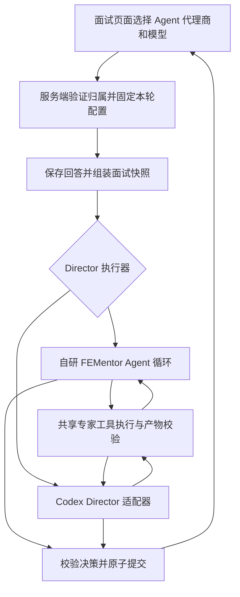

# FEMentor 自研面试 Agent 第一阶段方案

日期：2026-10-20

状态：范围已确认，具体设计供审阅，尚未实施。

第一阶段交付一个可在面试页面使用的自研 Agent。用户能够切换 Agent，保存自己的模型代理商和 API Key，选择模型，并完成工具调用、进度展示、回答评分和题目推进。已有 Codex Director 作为另一种执行器，与自研 Agent 共用面试契约。

用户已确认每个用户都能保存自己的代理商、模型和 API Key。下文的页面组织、协议范围、持久化方式和切换时机为本阶段建议设计。

## 用户操作

在账户设置中增加“模型与代理商”，支持新增、编辑、删除多组配置。每组包含名称、Base URL、API Key、支持的接口协议和模型列表；用户可以手动填写模型 ID。提供“验证连接”和能力检查，分别展示认证、模型请求、工具调用和结构化结果的验证状态。

在面试准备页和会话页增加 Agent、代理商、模型三个选择项。Agent 候选来自服务端可用目录；模型候选属于选中的代理商。展示本轮实际生效的组合及不可用原因。

第一阶段正式接入自研 FEMentor Agent 和已部署可用的 Codex Director。旧 workflow 保留原入口。尚未实现的执行器不作为可用选项。

开始面试前可以选择组合。进行中的面试只允许在没有运行任务、没有待处理失败回答时切换；新选择从下一次提交开始生效。运行期间禁用切换。切换后从已提交的面试记录构造上下文。

失败回答的重试沿用原来的配置快照。用户主动选择“使用新配置重试”时，创建新的 attempt 并记录新快照；原始题目和回答保持不可变。所有完成的提交仍按 submission ID 回放，避免重复评分。

## 当前基础与差距

| 当前实现 | 第一阶段改动 |
| --- | --- |
| Director 已有五种动作、上下文构建、专家产物校验和提交 | 抽出与执行器无关的入口，复用业务规则 |
| Director 配置和调用直接绑定 Codex | 增加按本轮服务端解析结果选择执行器的能力 |
| 回答持久化和重试的完整入口只覆盖 Codex | 扩展到两个 Director 执行器，保留相同提交约束 |
| LLM 配置保存在进程内存，按用户和登录令牌指纹索引 | 增加按稳定用户 ID 持久保存的代理商与模型配置 |
| 云端拒绝会话 LLM 配置，配置面板仅本地 native-api 可见 | 新增支持登录用户的账户配置接口和页面 |
| 普通 LLM 客户端只返回文本 | 增加完整模型消息、工具请求、结果回传和流式解析 |
| 浏览器已有 SSE 进度与结果通道 | 增加统一任务标识、工具进度、取消与恢复交互 |
| Codex 模型中继从环境变量读取模型和凭证 | 支持注入经服务端解析的用户配置，平台控制凭证独立维护 |

相关源码：

- [Director 配置](../../../apps/api/src/interview/director/config.js)
- [Director 服务](../../../apps/api/src/interview/director/service.js)
- [回答提交入口](../../../apps/api/src/interview/turn-service.js)
- [当前配置面板](../../../apps/web/components/RuntimeConfigPanel.tsx)
- [会话 LLM 配置](../../../apps/api/src/lib/session-llm-config-store.js)
- [普通模型客户端](../../../apps/api/src/llm.js)
- [Codex 模型中继](../../../apps/api/src/agent-runtime/codex/model-relay.js)
- [面试 SSE 路由](../../../apps/api/src/routes/interview-routes.js)

## 配置模型与保存方式

Agent、代理商和模型分别表示执行方式、模型服务入口、请求使用的模型 ID。用户可以选择组合；服务端负责检查归属、兼容性和运行预算，生成任务配置。

| 对象 | 关键内容 |
| --- | --- |
| 用户代理商配置 | ID、用户 ID、名称、Base URL、协议、凭证引用、修订号、状态 |
| 用户模型配置 | ID、所属代理商、模型 ID、显示名称、能力验证结果 |
| 个人默认选择 | Agent ID、代理商配置 ID、模型配置 ID |
| 面试默认选择 | 当前会话后续提交使用的组合及版本 |
| 运行快照 | submission、attempt、Agent 版本、代理商和模型修订、凭证版本引用、协议、预算、Skill 与 Schema 版本 |

配置按用户 ID 关联，不随登录令牌刷新丢失。PostgreSQL 保存云端配置；本地 SQLite 模式使用相同的存储接口和归属规则。新增迁移和兼容层覆盖实际支持的两种存储。

API Key 采用服务端加密保存，密钥由部署环境管理，与数据库分离。加密记录包含密钥版本；使用 AEAD 加密，并将用户 ID、配置 ID 和修订号绑定为附加认证数据。读取接口只返回掩码和是否已配置，编辑时省略 API Key 表示保留。浏览器在提交后清空输入，不将 Key 写入本地存储。

代理商修改产生新修订。任务开始前解析并固定完整配置；修改配置不会改变正在执行的任务，该任务在结束前使用已固定的凭据。凭证被替换后，旧版本不再供新运行解析，旧失败任务需由用户选择有效配置后重试。已启动请求的取消不等于上游一定未处理。

代理商配置删除采用停用标记，历史运行保留非敏感快照。运行中的配置暂不允许删除，待任务结束后处理。Key 删除后不可通过历史快照还原。

服务端验证用户填写的 Base URL，云端要求 HTTPS，限制目标地址和重定向，阻止访问回环、私网、链路本地及元数据地址。URL 中不接受凭证。能力验证也使用同一目标校验。错误和日志经过脱敏，不保存请求认证头或完整模型输入。

## Agent 运行与业务提交

建议增加统一的 Director 执行入口，接收任务包、已解析的运行配置、工具执行回调、取消信号及事件回调。任务包沿用当前完整题目、原始回答、简历、JD、历史和允许话题。

业务侧继续负责保存回答、领取 attempt、装配上下文、保存专家产物、校验引用和原子提交。执行器负责模型消息与工具循环。运行目录负责声明支持的任务、协议和能力，不能只根据 Runtime 名称判断是否可用。



自研循环支持模型提出工具请求、等待已校验的工具结果、继续决策，最后返回 `decision`。第一版沿用最多四次主模型请求和两次串行专家调用；总期限、单次请求期限和输出大小由服务端配置并实际执行。

两个执行器复用 `interview-director`、`frontend-answer-evaluation`、`interview-question-design` 的规则和输出契约。自研路径的评分与出题专家使用有固定 Schema 的模型请求，不再各自运行工具循环。Codex 路径保留已有专家执行方式。

第一阶段同一运行内主 Agent 和两个专家使用同一用户选择的代理商与模型。这样更换模型能覆盖整轮面试。未来按角色分别选择模型可在此基础上扩展。

原有 AgentRuntime 生命周期可继续使用，但需补充任务包、工具执行、外部取消及配置快照的传递方式。不能仅新增 Runtime 枚举并复用目前只面向评分的调用入口。

## Harness 模块

Harness 是负责让一次 Agent 运行可控完成的程序层。建议分成以下模块，沿用现有业务服务与校验器：

| 模块 | 职责 |
| --- | --- |
| RunCoordinator | 领取 attempt、固定配置、管理期限和取消、归集调用用量与运行状态 |
| ContextManager | 从业务记录构建上下文、选择历史、生成结构化摘录、检查每次请求预算 |
| AgentLoop | 调用模型、识别完整工具请求、回填结果、判断是否产生最终决策 |
| ToolExecutor | 参数与归属校验、专家执行、调用去重、产物保存、结果摘要 |
| ProviderTransport | 模型协议、流式分片、完整消息与工具请求解析、上游错误和取消 |
| Validator 与 Committer | 校验决策和当前 attempt 的产物引用，原子提交评分及题目状态 |

宿主通过 RunCoordinator 管理两种执行器。自研 Runtime 使用自己的 AgentLoop；Codex 使用既有内部循环与适配器。共用的业务上下文由 ContextManager 准备，最终请求还须在各自模型传输边界检查预算。

自研单轮顺序如下：

1. 固定用户配置和原始回答，读取已提交的面试快照。
2. ContextManager 组装上下文并检查预算。
3. ProviderTransport 请求模型，AgentLoop 读取完整结果。
4. 若为工具请求，ToolExecutor 校验、执行、保存并回填结果，然后回到步骤 2。
5. 若为最终决策，Validator 校验，Committer 提交，之后才向候选人发送正式结果。
6. 每次循环都检查取消、剩余期限、模型请求次数和工具次数；失败释放运行资源并保存可重试状态。

## 上下文压缩

### 当前实现

[turn-context.js](../../../apps/api/src/interview/turn-context.js) 已实现按预算选取历史：能容纳时发送完整历史，否则优先最近两轮、再选择与题目词面相关的完整轮次，对其余轮次生成问题、回答、分数和弱项的字段摘录。它会记录完整、摘录和遗漏轮数。这是确定性摘录，不是模型生成的语义摘要；返回对象中的 `summary` 和 `openPoints` 目前仍是空值。

[token-budget.js](../../../apps/api/src/interview/token-budget.js) 使用全局环境配置，默认窗口 65536、输出预留 8192、安全预留 2048 Token。Director 初始任务包还预留 16384 Token 的后续输入空间。Codex 中继检查实际转发请求，超预算时拒绝；目前未实现通用的循环内重新压缩。

### 上下文分层

面试业务记录始终是事实来源。上下文压缩只改变这一次请求携带哪些材料，不修改原始回答、正式评分或面试状态。

| 层 | 内容 | 压缩规则 |
| --- | --- | --- |
| 必需输入 | 服务端规则、工具与输出 Schema、当前题目、完整原始回答、当前合法状态和必要产物引用 | 每次请求重新装配，不静默裁切 |
| 当前运行 | 已完整接收的模型工具请求、匹配的工具结果、调用状态 | v0 保留本轮全部工具交换，保证 call 与 result 配对 |
| 近期历史 | 最近完整对话及与当前话题相关的轮次 | 优先保留完整轮次，预算不足时按轮次转为摘录 |
| 较早历史 | 已问话题、已提交评分与弱项、候选人原话摘录、未完成追问 | 生成有来源引用的结构化摘要 |
| 补充材料 | 简历、JD 的相关片段及其他获准材料 | 按相关性选择，记录来源与省略情况 |

第一阶段按原记录提取结构化摘要：已问话题、评分和动作复制宿主字段，候选人陈述保留摘录及原始提交引用；未完成追问从已提交的题目状态推导。摘要不推断新的能力分数，也不把候选人自述升级为已验证事实。

摘要及其缓存只覆盖已完成提交，记录 covered submission IDs、来源修订或 hash、摘要策略版本和遗漏项。澄清与跳过也可能没有评分 turn，因此不以评分轮次序号作为唯一覆盖标识。摘要命中后合并覆盖范围之外的近期原始记录，范围去重。源记录变化或策略版本变化时失效重建。

若后续增加 LLM 语义摘要，作为独立可选策略接入：独立预算、来源引用、Schema 校验，并对压缩前后事实和动作进行对照评估。Schema 合法不能证明摘要准确；失败时回退确定性摘录。v0 不依赖额外摘要模型请求。

### 预算和触发

窗口预算属于具体的代理商、模型、协议与配置修订。增加上下文窗口、最大输入、输出预留和计数方式的元数据，并区分配置声明与已核实约束。用户填写更大窗口不会自动提高服务端允许的上限。能力探测成功也不能证明代理商支持完整的标称窗口。

计算方式：

```text
单次请求输入预算 =
  min(模型窗口 - 输出预留, 代理商最大输入, 服务端输入上限)
  - 安全余量

历史可用预算 =
  单次请求输入预算
  - 必需输入
  - 当前运行消息
  - 下一次工具结果预留
```

计数覆盖最终请求的规则、消息、工具定义和输出 Schema；转换成上游协议后再次检查。自研传输的估算不等于上游精确计数，无法精确计数的模型使用明确标记的估算和更保守余量；Token 限额与请求字节限额同时执行。

建议初始策略在输入估算达到预算 80% 时触发整理，以 65% 为目标腾出空间；这些比例是待调优默认值。必需输入优先，不能为了达到目标比例而删去它。压缩后再次计数，始终检查硬预算。

压缩按顺序处理：避免重复装配历史、缩短补充材料、把较早历史转换成结构化摘录、减少低相关完整历史。工具结果在首次送回主 Agent 前就生成受控摘要，完整产物保留在宿主。

当前运行最多两次工具调用，v0 不删除本轮任何工具调用与结果消息。压缩发生在下一次模型请求前；未完成的工具参数流和正在执行的工具都不作为压缩边界。每次工具结果回填后重新检查预算。

若完整当前回答、必要规则和本轮工具交换本身超过硬预算，终止本次运行并保留回答，提示调整材料或选择容量足够的模型。上游返回上下文超限时记录估算偏差，本次返回可重试错误，不自动重放工具或切换模型。

### 切换与恢复

切换 Agent 或模型时，根据业务快照及新模型预算重建上下文；可复用带来源的历史摘要，但不能沿用旧模型的预算或私有会话对象。

每次上下文构建记录完整提交引用、摘要覆盖范围、遗漏项、Token 估算、策略版本与压缩原因。它用于解释一次运行使用了哪些材料，不作为新的正式面试状态，也不记录隐藏推理。

进程中断后，第一阶段仍按已保存回答创建新 attempt。历史摘要可以重建，旧 attempt 的专家产物只作审计，不授予新 attempt 提交权。本阶段不承诺从工具循环中间续跑。

## 工具调用

首期保留 `run_expert`，其 expert 只允许 `evaluate_answer` 和 `design_question`。原始回答、题目、用户和 attempt 都由宿主绑定；模型只提交分析目的和允许的话题。

统一工具请求至少包含 run ID、attempt ID、call ID、工具名和参数。运行归属由受信调用上下文确定，不采用模型提供的身份。收到完整参数并通过校验后才执行工具；分片中的不完整 JSON 不触发执行。

每个 call ID 在同一 attempt 中只能对应一次工具执行和同一组参数。已完成调用返回保存的结果；重复或冲突请求不能再次产生评分产物。失败或旧 attempt 的产物不能用于本次决策。

专家结果先通过 Schema 校验并保存，再把产物 ID 和受控摘要送回主 Agent。主 Agent 返回的五种动作及引用继续经过现有校验器；模型输出被视为候选结果，正式分数和题目状态由提交程序写入。

工具事件对前端只提供工具名称、状态、耗时和适合展示的摘要。候选人看到“正在评估回答”“正在设计追问”等进度，内部提示和模型推理不进入界面。

## 模型与事件传输

传输分为三条链路，分别验收。

| 链路 | 第一阶段设计 |
| --- | --- |
| 浏览器与服务端 | 复用 HTTP 提交和 SSE，统一运行标识、进度、结果和错误 |
| 自研 Agent 与模型服务 | 首期支持 OpenAI compatible Chat Completions 的工具调用，处理完整消息和流式分片 |
| Agent 与宿主工具 | 自研路径使用受控函数调用，Codex 保留动态工具通道，两者映射到同一工具契约 |

现有 Codex 模型中继使用 Responses 协议。用户代理商只有在该模型与协议组合通过验证后才能用于 Codex；支持 Chat Completions 不代表支持 Codex。

连接检查分成基本认证、选定模型、对应协议、工具调用和结构化输出检查。验证使用固定合成输入，界面说明会产生少量模型请求。检查结果绑定配置修订和协议，配置变化后重新验证。查询模型列表只作为填写辅助，不能作为兼容性证明。

自研传输适配器保留工具 call ID、工具名称、参数分片、结束状态和 usage。工具参数在完整接收后解析。请求超时、取消、工具预算耗尽、无效输出和上游错误统一映射为可理解的失败状态。没有 usage 的请求记为未知，不用零代替。

保留现有 `meta`、`stage`、`token`、`result`、`done`、`error` SSE 事件，并补充 `tool` 事件。任务相关事件包含 submission ID、attempt ID、run ID 和本轮递增序号；前端据此忽略旧 attempt 的迟到消息。

Director 的内部文本流不直接显示。处理中传输阶段和工具状态；候选人可见回复及 `result` 在业务提交成功后发送。`done` 结束传输，不单独证明提交成功。

前端增加取消请求控制，并将取消传播到主模型请求和专家调用。保持当前断连取消运行的语义；刷新后通过提交记录确认完成或可重试状态。若提交成功后响应丢失，读取已保存结果；若尚未提交，由用户显式重试。第一阶段不新增断线后台续跑或完整 SSE 历史重放。

## 配置接口与页面

建议使用独立的用户配置资源，避免把账户配置混入旧的会话内存接口。

| 接口用途 | 行为 |
| --- | --- |
| 获取 Agent 目录 | 返回已启用执行器、所需协议、可用状态和原因 |
| 用户代理商配置增删改查 | 所有操作按当前认证用户限定，读取不返回 Key |
| 代理商模型配置 | 保存模型 ID 和显示信息，支持手动填写 |
| 配置验证 | 使用指定配置修订执行有限能力探测 |
| 个人默认选择 | 保存用户偏好，服务端重新验证可用性 |
| 面试组合选择 | 更新下一次提交的默认组合，运行中拒绝修改 |
| 面试提交与重试 | 接受选择引用，服务端解析并保存运行快照 |

新接口在 Fastify 主入口实现。账户设置页展示代理商配置；面试页面使用简洁选择器，只展示与当前任务有关的 Agent、代理商、模型及连接状态。应用 API 地址保留在开发配置中，与模型代理商地址分开展示。

普通用户只能管理自己的配置。平台提供的默认配置作为独立只读选项，使用前明确展示；用户自带 Key 失败时不自动改用平台 Key 或其他代理商。

## 开发顺序

1. 固定运行配置快照、工具调用、上下文预算和事件契约，抽出 Director 与 Codex 的耦合。同时把回答持久化入口改为按能力分流。
2. 实现用户代理商、模型和默认选择的存储、凭证加密、归属检查、能力验证，以及账户配置页面。
3. 实现 ContextManager、自研模型传输和工具循环，让主 Agent、评分专家、出题专家使用选定用户配置，完成单轮提交。
4. 为 Codex 注入相同来源的用户模型配置，保留平台沙箱控制配置；接入面试页切换与完整事件展示。
5. 使用两种执行器和真实用户配置完成浏览器验收，再记录耗时、请求数、Token 和恢复结果。

每一步的完成应有可观察的结果：配置能保存、调用确实使用所选模型、工具能返回有效产物、页面能切换执行器、提交能从失败中恢复。

## 第一阶段验收

- 两个用户各自保存配置，互相不能读取、验证或使用对方的配置；浏览器、SSE 和日志不出现明文 Key。
- 用户重新登录和服务重启后，代理商、模型和默认选择仍可用；删除 Key 后旧快照不能重新取出凭证。
- 面试页能选择自研 Agent 和部署可用的 Codex Director；当前运行锁定配置，下轮切换使用新组合。
- 实际请求的代理商、模型和协议与运行快照一致，主 Agent 和专家遵守同一选择；配置失败不会静默换源。
- 完成澄清、弱回答追问、完整回答换题、跳过和结束；已有技术内容的弱回答仍进入评分。
- 工具参数分片、重复 call ID、预算超限、非法产物引用和过期 attempt 得到正确处理。
- 压缩后完整保留当前题目和回答，本轮工具 call 与 result 仍配对，评分及产物引用不变；摘要不重复计入历史，不制造新的能力结论。
- 切换到较小窗口模型时重新计算预算；必要材料过大时明确失败并保留回答；分别覆盖长历史、超大工具结果和上游上下文超限。
- 记录压缩前后输入估算、完整和摘录提交数、遗漏范围；对同一面试样本比较压缩前后的动作及评分，不能只以 Token 减少判断成功。
- 自研流式响应、Codex 通道和浏览器 SSE 分别验证正常结束、错误、断连和取消；提交成功后才出现正式结果。
- 取消或失败后可以恢复已保存回答；重复提交和重试不重复计分或推进题目。
- 同一组固定题目与回答用于比较两个执行器，记录动作、工具次数、完整耗时和可获得的 Token 数据。

验收分为契约和存储检查、真实模型集成、浏览器交互三层。配置探测通过不能代替面试集成通过，接口通过也不能代替浏览器验收。
